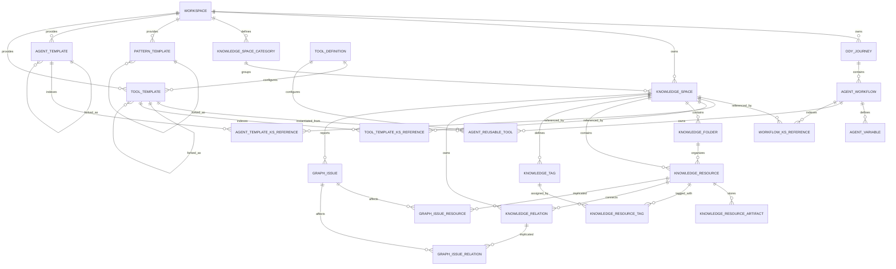
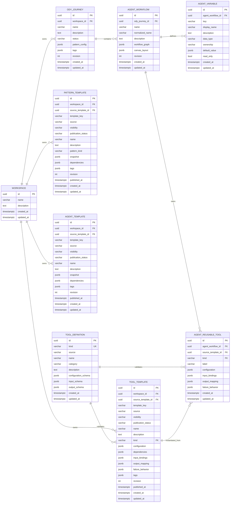
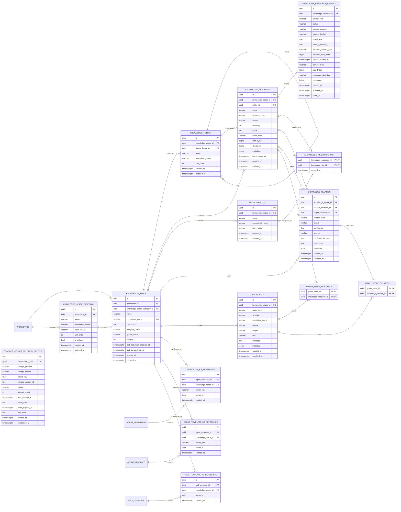

# Odyssey V1 Database Design — Review Draft

> 状态：**已批准的 V1 Implementation Baseline，尚未生成 SQLAlchemy Model 或 Alembic Migration**  
> 依据：[`doc/architecture/data/contracts/canonical-json-contracts-draft.md`](../../contracts/canonical-json-contracts-draft.md)  
> 设计约束：[`doc/architecture/domain/odyssey-v1-design-constraints.md`](../../../domain/odyssey-v1-design-constraints.md)

约束冲突时按以下顺序解释：V1 设计约束 → canonical JSON contracts → Knowledge Space specification → 其他 detail-design → 历史 implementation/database 文档。已明确确认的产品回复高于文档中的旧建议。

## 1. 设计目标

数据库服务于 Odyssey 当前编辑状态和可复用组件库，不负责保存运行时执行状态。

核心原则：

1. Journey、AgentWorkflow、Knowledge Space、Template 是独立持久化聚合。
2. Pattern、Workflow Graph、Canvas Layout 和 Template Snapshot 使用经过 schema 校验的 JSONB。
3. 需要独立 CRUD、外键保护、唯一约束或反向查询的数据使用关系表。
4. Workflow JSON 是节点配置和资源引用的业务真相。
5. Knowledge Space 引用关系表是由 Workflow JSON 生成的查询索引，不是第二份业务配置。
6. V1 不创建 Workflow Version、Journey Release 或运行时执行表。
7. 所有实体和 JSON 内嵌领域对象统一使用 UUID。
8. 当前数据库没有业务数据，因此确认设计后可以重写初始 migration。
9. Pattern、Agent、Tool Template 均保留所有权，并支持 private/public；公开模板不能暴露作者的私有资产引用。

## 2. JSON 与关系表边界

| 数据 | 存储方式 | 原因 |
| --- | --- | --- |
| Journey metadata | 关系字段 | 列表、搜索、状态过滤 |
| PatternConfig | `ody_journey.pattern_config` JSONB | Slot/Route 结构随 Pattern 演进 |
| Agent identity | `agent_workflow` 关系字段 | 独立 CRUD 和 Journey ownership |
| WorkflowGraph | `agent_workflow.workflow_graph` JSONB | Node 类型和配置持续演进 |
| CanvasLayout | `agent_workflow.canvas_layout` JSONB | 高频局部布局数据，与业务图分离 |
| Agent Variables | `agent_variable` 表 | 唯一约束、引用检查和面板 CRUD |
| Task-local Variables | Workflow JSONB | 只属于一个 Task Node |
| Task Tool Steps | Workflow JSONB | 严格属于 Task，有序且不独立 CRUD |
| AgentReusableTools | `agent_reusable_tool` 表 | Agent Workflow 内独立配置和复用 |
| Pattern/Agent/Tool Templates | 独立表 + snapshot JSONB | 模板库检索、复制和导入导出 |
| Knowledge Space metadata | 关系表 | 独立资产 CRUD |
| Knowledge file metadata | 关系表 | 文件树、状态、对象存储引用 |
| KS references from Workflow | JSONB + 派生关系索引 | 保持可移植性，同时支持外键和反向查询 |

## 3. 高层 ER 图



说明：Built-in Template 和 Tool Definition 可以使用 `workspace_id = NULL` 表示系统级数据；用户创建的 Template 必须属于 singleton Workspace。

## 4. Journey 与组件库 ER 图



## 5. Knowledge Space ER 图



`owner_id` 指向 Workflow JSON 或 Agent Template Snapshot 内部的 Agent Action Node、Reusable Tool 或 Task Tool UUID。因为这些对象位于 JSONB 中，数据库不能对 `owner_id` 建普通外键；后端在保存聚合时负责 schema 和引用完整性校验。

## 6. 表设计

### 6.1 `workspace`

V1 为单用户、单 Workspace。

| 字段 | 类型 | 约束 |
| --- | --- | --- |
| `id` | UUID | PK |
| `name` | VARCHAR(255) | NOT NULL |
| `description` | TEXT | NULL |
| `created_at` | TIMESTAMPTZ | NOT NULL |
| `updated_at` | TIMESTAMPTZ | NOT NULL |

应用层保证只创建一个 Workspace；不为了 singleton 约束引入固定主键。Workspace 不提供绕过 bootstrap 的普通 create repository/API；bootstrap 必须在一个事务中同时创建 Workspace 和默认 Category，任一步失败整体回滚，不能留下没有默认 Category 的 Workspace。

### 6.1.1 `knowledge_space_category`

该表仅用于给同一 Workspace 内的 Knowledge Spaces 分组，不表示 Workspace 类型或多个 Workspace。UI 可继续显示简短标签 “Category”。

| 字段 | 类型 | 约束 |
| --- | --- | --- |
| `id` | UUID | PK |
| `workspace_id` | UUID | FK → `workspace.id`, NOT NULL, ON DELETE RESTRICT |
| `name` | VARCHAR(255) | NOT NULL |
| `normalized_name` | VARCHAR(255) | NOT NULL，服务端生成 |
| `color_token` | VARCHAR(64) | NULL |
| `sort_order` | INTEGER | NOT NULL，默认 0，CHECK >= 0 |
| `is_default` | BOOLEAN | NOT NULL，默认 false |
| timestamps | TIMESTAMPTZ | NOT NULL |

`UNIQUE(workspace_id, normalized_name)`，并使用 partial unique index `UNIQUE(workspace_id) WHERE is_default = true` 保证每个 Workspace 至多一个默认 Category。Workspace bootstrap 在创建 Workspace 的同一事务中创建恰好一个默认 Category。服务层禁止删除默认 Category，也禁止把它的 `is_default` 改为 false；普通 Category 被 Knowledge Space 引用时删除使用 RESTRICT，UI 必须先把相关 KS 原子移动到另一 Category。并发创建第二个默认 Category 由 partial unique index 拒绝。

### 6.2 `ody_journey`

| 字段 | 类型 | 约束 |
| --- | --- | --- |
| `id` | UUID | PK |
| `workspace_id` | UUID | FK → `workspace.id`, NOT NULL |
| `name` | VARCHAR(255) | NOT NULL |
| `description` | TEXT | NULL |
| `status` | VARCHAR(16) | `draft`, `archived`，数据库 CHECK |
| `pattern_config` | JSONB | NOT NULL，canonical `PatternConfig` |
| `tags` | JSONB | NOT NULL，字符串数组 |
| `revision` | INTEGER | NOT NULL，默认 1 |
| `created_at` | TIMESTAMPTZ | NOT NULL |
| `updated_at` | TIMESTAMPTZ | NOT NULL |

约束和索引：

- `CHECK revision >= 1`
- index `(workspace_id, status, updated_at DESC)`
- 可选 GIN index `tags`，V1 数据量较小时可以暂缓

Journey V1 没有 publish/release 行为，也不保存 `published_at`；Template publication 是另一套独立语义。

`pattern_config` 保存 Slots、Routes、`kind`、`templateKey` 和配置；不创建 Pattern Slot/Route 表。

### 6.3 `agent_workflow`

| 字段 | 类型 | 约束 |
| --- | --- | --- |
| `id` | UUID | PK |
| `ody_journey_id` | UUID | FK → `ody_journey.id`, NOT NULL |
| `name` | VARCHAR(255) | NOT NULL |
| `normalized_name` | VARCHAR(255) | NOT NULL；由服务端根据 `name` 生成 |
| `description` | TEXT | NULL |
| `workflow_graph` | JSONB | NOT NULL |
| `canvas_layout` | JSONB | NOT NULL |
| `revision` | INTEGER | NOT NULL，默认 1 |
| `created_at` | TIMESTAMPTZ | NOT NULL |
| `updated_at` | TIMESTAMPTZ | NOT NULL |

约束和索引：

- index `ody_journey_id`
- `UNIQUE(ody_journey_id, normalized_name)`，同一 Journey 内 Agent 不允许同名
- `normalized_name` 由服务端统一执行 trim、Unicode normalization 和大小写归一化；客户端不得自行提交最终值
- `CHECK revision >= 1`
- `workflow_graph` 必须通过 Pydantic/canonical schema 校验
- `canvas_layout` 必须引用同一 Workflow 中存在的 Node UUID
- 不保留 `current_version_id`

删除 Journey 时级联删除 AgentWorkflow；删除 AgentWorkflow 时级联删除 Variables、AgentReusableTools 和 KS reference index。

### 6.4 `agent_variable`

| 字段 | 类型 | 约束 |
| --- | --- | --- |
| `id` | UUID | PK |
| `agent_workflow_id` | UUID | FK，NOT NULL |
| `key` | VARCHAR(255) | NOT NULL |
| `display_name` | VARCHAR(255) | NOT NULL |
| `description` | TEXT | NULL |
| `data_type` | VARCHAR(32) | `string`, `number`, `boolean`, `json` |
| `ownership` | VARCHAR(32) | `user_managed`, `shared`, `agent_managed`，数据库 CHECK |
| `default_value` | JSONB | NULL |
| `read_only` | BOOLEAN | NOT NULL，默认 false |
| `created_at` | TIMESTAMPTZ | NOT NULL |
| `updated_at` | TIMESTAMPTZ | NOT NULL |

唯一约束：`UNIQUE(agent_workflow_id, key)`。

Task-local Variables 不进入此表，保留在所属 Task Node JSON 中。

### 6.5 `agent_reusable_tool`

| 字段 | 类型 | 约束 |
| --- | --- | --- |
| `id` | UUID | PK |
| `agent_workflow_id` | UUID | FK，NOT NULL |
| `source_template_id` | UUID | FK → `tool_template.id`, NULL |
| `kind` | VARCHAR(128) | FK → `tool_definition.kind`, NOT NULL |
| `label` | VARCHAR(255) | NULL |
| `configuration` | JSONB | NOT NULL |
| `input_bindings` | JSONB | NOT NULL |
| `output_mapping` | JSONB | NULL |
| `failure_behavior` | JSONB | NOT NULL |
| timestamps | TIMESTAMPTZ | NOT NULL |

`source_template_id` 只记录来源。删除 Tool Template 时使用 `ON DELETE SET NULL`，不能删除已经实例化的 AgentReusableTool。

### 6.6 Template tables

`pattern_template`、`agent_template`、`tool_template` 使用相同的公共元数据：

| 字段                   | 类型           | 说明                                                 |
| -------------------- | ------------ | -------------------------------------------------- |
| `id`                 | UUID         | PK                                                 |
| `workspace_id`       | UUID         | 用户模板必填；built-in 为 NULL                             |
| `source_template_id` | UUID         | 同类 Template 自引用 FK；fork/复制来源，可空，ON DELETE SET NULL |
| `template_key`       | VARCHAR(255) | built-in 稳定 key；用户模板可为 NULL                        |
| `source`             | VARCHAR(32)  | `built_in` 或 `user`                                |
| `visibility`         | VARCHAR(16)  | `private` 或 `public`                               |
| `publication_status` | VARCHAR(16)  | `draft`, `published`                               |
| `name`               | VARCHAR(255) | NOT NULL                                           |
| `description`        | TEXT         | NULL                                               |
| `dependencies`       | JSONB        | 公开模板实例化时需要映射的外部依赖槽位                                |
| `tags`               | JSONB        | 字符串数组                                              |
| `revision`           | INTEGER      | NOT NULL，默认 1，CHECK >= 1                           |
| `published_at`       | TIMESTAMPTZ  | NULL                                               |
| timestamps           | TIMESTAMPTZ  | NOT NULL                                           |

额外字段：

- `pattern_template.pattern_kind` + `snapshot JSONB`
- `agent_template.snapshot JSONB`
- `tool_template.kind`、`configuration`、bindings、mapping 和 failure behavior

约束：

- built-in：`workspace_id IS NULL AND template_key IS NOT NULL`
- user：`workspace_id IS NOT NULL`
- built-in 默认 `visibility = public`、`publication_status = published`
- 新建用户模板默认 `visibility = private`、`publication_status = draft`
- 未来 Community 只查询 `visibility = public AND publication_status = published`
- `UNIQUE(template_key)` 仅对非 NULL built-in key 生效
- Template Snapshot 不包含 secret，不复制 Knowledge Space 内容
- `source_template_id` 只记录 lineage；fork 后的新模板与来源不实时联动
- built-in Template 由 seed/migration 管理，不允许用户通过普通删除 API 删除
- 上述 source/workspace/key 规则使用命名 CHECK；非 NULL built-in `template_key` 使用 partial UNIQUE index
- 用户 Template 的 `template_key` 必须为 NULL；普通用户 CRUD 不得修改 `source`、built-in ownership 或 built-in snapshot
- `publication_status = published` 时 `published_at IS NOT NULL`；`draft` 时 `published_at IS NULL`

#### Template visibility 与外部依赖

Private Template 可以直接引用同一 Workspace 内的 Knowledge Space UUID，并通过引用索引表获得删除保护。

Public Template 不得直接包含作者的私有 Knowledge Space UUID、名称、文件或凭据。发布前必须把这些引用转换为 `dependencies` 中的抽象槽位：

```json
{
  "id": "0195f076-b6e6-7ef0-98db-d721990f8d01",
  "kind": "knowledge_space",
  "key": "research_knowledge",
  "label": "Research Knowledge",
  "required": true
}
```

其他 Workspace 使用或 fork Public Template 时，需要先将依赖槽位映射到自己的 Knowledge Space，再生成本地 Template 或当前实例。

公开/导出净化不是递归扫描任意字符串。`tool_definition.configuration_schema` 必须用 schema metadata 标记：

- `x-odyssey-sensitive: true`：credential、token、password 等禁止以 literal 进入公开或导出 Snapshot；
- `x-odyssey-reference-kind: knowledge_space`：这是可解析和可替换的 KS 引用字段；
- secret reference/vault 尚未实现，因此 V1 对敏感 literal 直接拒绝发布。

发布事务：

1. 校验 Snapshot/configuration。
2. 仅沿 typed schema 标记字段收集 private external references 和 sensitive literals。
3. 将可映射引用转换为 dependency slots，或拒绝发布。
4. 执行 secret 和敏感字段检查。
5. 重建 Template KS reference index。
6. 设置 `visibility = public`、`publication_status = published` 和 `published_at`。
7. 在同一数据库事务中提交；任一步失败均回滚，Template 继续保持原状态。

事务完成后的公开 Snapshot 不得包含作者私有 KS 的 UUID、名称、文件 metadata/content 或任何 literal credential。

Community listing、审核、点赞、下载量和评论未来使用独立社区表扩展，不进入当前 V1 表。

### 6.7 `tool_definition`

| 字段 | 类型 | 约束 |
| --- | --- | --- |
| `id` | UUID | PK |
| `kind` | VARCHAR(128) | UNIQUE, NOT NULL；同时作为配置实例的稳定引用键 |
| `source` | VARCHAR(32) | V1 为 `built_in` |
| `name` | VARCHAR(255) | NOT NULL |
| `category` | VARCHAR(64) | NOT NULL |
| `description` | TEXT | NULL |
| `configuration_schema` | JSONB | NOT NULL |
| `input_schema` | JSONB | NOT NULL |
| `output_schema` | JSONB | NOT NULL |
| timestamps | TIMESTAMPTZ | NOT NULL |

V1 五种 kind：

```text
knowledge_retrieval
script_execution
api_request
set_variable
llm_call
```

数据库和 Portable JSON 都通过稳定 `kind` 引用 Definition。`tool_template.kind` 和 `agent_reusable_tool.kind` 使用外键指向 `tool_definition.kind`，不重复保存 Definition UUID。

### 6.8 Knowledge Space tables

#### `knowledge_space`

- `knowledge_space_category_id`：FK → `knowledge_space_category.id`，NOT NULL，ON DELETE RESTRICT；Category 必须属于同一 Workspace。
- `UNIQUE(workspace_id, normalized_name)`，禁止同一 Workspace 内同名。
- `normalized_name` 由服务端统一执行 trim、Unicode normalization 和大小写归一化。
- `lifecycle_status`：`initializing`, `ready`, `syncing`, `failed`；不包含 `archived`，因为已确认 V1 的 KS 使用确认后硬删除。
- `graph_status`：`not_indexed`, `healthy`, `needs_review`, `error`；query-friendly cached field，由 domain service 管理，普通客户端不得提交。
- `revision` 支持并发更新保护。
- `last_document_indexed_at`、`last_steward_run_at` 可空，供列表和 Inspector 展示；V1 seed/mock 数据可直接维护，未来由 engine 更新。
- 不保存 `latest_graph_snapshot_id`：V1 仅维护当前图，不保留 Graph Snapshot 历史。

V1 中“存在可用当前图”定义为：同一 KS 至少有一个 `knowledge_resource.status IN ('indexed', 'needs_review')`。每次创建/变更/删除 Resource、Relation、Issue 或 Issue assignment 的事务，都在提交前按同一个 domain service 重算 `graph_status`：

1. 没有可用当前图 → `not_indexed`；
2. 存在 `resolution_status = open AND severity = error` 的 Issue → `error`；
3. 存在 `resolution_status = open AND severity = warning` 的 Issue，或存在 `status = needs_review` 的 Resource/Relation → `needs_review`；
4. 其他情况 → `healthy`。

`accepted`、`resolved`、`dismissed` Issue 不再影响状态；`info` Issue 单独存在时不降低 graph status。seed/mock import 也必须调用相同重算服务，不能直接信任导入的 `graph_status`。

#### `knowledge_folder`

- V1 明确采用 virtual-root：Knowledge Space 根节点是 API/UI 投影，不创建 `knowledge_folder` 行。
- `parent_folder_id = NULL` 表示该 Folder 是 virtual root 下的一级 Folder。
- `knowledge_resource.folder_id = NULL` 表示 Resource 直接位于 virtual root。
- API/前端统一用可计算的非数据库标识 `virtual-root:<knowledgeSpaceId>` 表示根节点，并携带 `nodeType = virtual_root`；该值不得写入任何 UUID/FK 字段。
- `UNIQUE(knowledge_space_id, parent_folder_id, normalized_name)`；实现时需要处理 PostgreSQL NULL 的唯一语义，可使用 `NULLS NOT DISTINCT` 或两个 partial unique indexes。
- 父 Folder 必须属于同一 Knowledge Space，由服务层校验。
- 顶层 Folder 重名、根文件移动到 Folder、Folder 内文件移动到根目录，都必须覆盖在 repository/integration tests 中。

#### `knowledge_resource`

- V1 `resource_type = file`。
- `status` 是文档索引状态：`pending`, `indexing`, `indexed`, `needs_review`, `unsupported`, `failed`。`unsupported` 文件仍保留在 KS/file tree 中，但不构成可用图节点；`needs_review` 构成可用节点并使 graph status 至少为 `needs_review`。
- `summary`、`guide` 为 Inspector 所需的可空文本；V1 可由用户或 seed/mock 写入。
- Resource 不直接保存 provider/bucket/object key；实际 OSS locator 位于 `knowledge_resource_artifact`。
- `mime_type`、`size_bytes`、`checksum` 是 current original Artifact 的查询缓存，只能由 Artifact 激活事务更新；`size_bytes` CHECK >= 0。
- `last_indexed_at` 可空。
- `checksum` 用于上传完整性和可选去重提示，不默认跨 Knowledge Space 合并文件。
- Folder 可空，表示根目录文件。

#### `knowledge_resource_artifact`

Artifact 是 Resource 原文件和大型派生内容的 OSS 索引。字段、状态机、上传/替换/读取安全与 reconciliation 以 `doc/architecture/data/storage/v1-object-storage-design.md` 为准。

- `artifact_kind`：`original`, `extracted_text`, `preview`, `thumbnail`, `ocr_result`。
- `status`：`staging`, `active`, `failed`, `superseded`。
- 保存 `storage_provider`、`storage_bucket`、`object_key` 和可空 `storage_version_id`；不保存永久 URL。
- staging 保存 `declared_content_type`、`declared_size_bytes` 和 `upload_expires_at`；V1 只校验单文件上限，不实施 Workspace quota。
- 保存可信 `content_type`、`size_bytes`、SHA-256 checksum；active 时这些字段完整。
- `UNIQUE(storage_provider, storage_bucket, object_key)`，object key 永不复用。
- Partial unique：同一 Resource/Artifact kind 最多一个 active Artifact。
- Named CHECK：staging 不得有 activated/failed 时间；active 必须有可信 content type/size/checksum/activated time；superseded 必须曾激活且没有 failed time；failed 必须有 failed time 且从未激活。
- Complete/Replace 必须先锁定 Resource row，再重新校验 staging/active 状态并完成 supersede → activate → cache/outbox/revision 的单事务切换；partial unique 只作为最终保护。
- 首次 original staging 失败且没有 active original 时 Resource 进入 failed；替换 staging 失败时保留旧 active original 和 Resource 状态。
- Resource 删除时 Artifact rows CASCADE，但服务必须先在同一事务为所有实际对象创建 deletion outbox rows。

#### `knowledge_tag`

Tag 是 Knowledge Space 内可复用的标签定义，同时也是 Knowledge Family 只读视图的稳定分组标识：

- `id`：UUID PK。
- `knowledge_space_id`：FK，NOT NULL，删除 Knowledge Space 时 CASCADE。
- `name`：VARCHAR(255)，NOT NULL。
- `normalized_name`：VARCHAR(255)，NOT NULL，由服务端统一归一化。
- `color_token`：VARCHAR(64)，NULL；只保存设计系统 token，不保存任意 UI 样式。
- timestamps：TIMESTAMPTZ，NOT NULL。
- `UNIQUE(knowledge_space_id, normalized_name)`，禁止同一 Knowledge Space 内出现归一化后同名的 Tag。

#### `knowledge_resource_tag`

Resource 与 Tag 是多对多关系：

- `knowledge_resource_id`：FK，NOT NULL，删除 Resource 时 CASCADE。
- `knowledge_tag_id`：FK，NOT NULL，删除 Tag 时 CASCADE。
- `created_at`：TIMESTAMPTZ，NOT NULL。
- `PRIMARY KEY(knowledge_resource_id, knowledge_tag_id)`，禁止重复分配。
- 服务层必须校验 Resource 与 Tag 属于同一个 Knowledge Space。

V1 的标签由用户、seed/mock 或普通 CRUD 维护，暂不保存 engine 专用的 `confidence`、`source` 和确认状态；未来引入自动标注时再通过 migration 增加。

#### Knowledge graph 与 Family 投影

- `knowledge_resource` 是图节点。
- `knowledge_relation` 是同一 Knowledge Space 内节点之间的边。
- `knowledge_tag` 与 `knowledge_resource_tag` 定义节点分组。
- Knowledge Family 不是独立持久化实体，而是按一个 `knowledge_tag.id` 聚合其 Resource 得到的只读视图。
- Family 的 `memberCount`、边界和状态均为派生数据；V1 不保存 Family layout，由前端根据当前节点和关系自动布局。

因此 V1 不创建 `knowledge_family` 或 `knowledge_family_resource` 表，避免 Tag assignment 与 Family membership 成为两套可能不一致的事实来源。没有 engine 时，Graph 和 Family 可通过 seed/mock 或普通 CRUD 数据展示。

#### `knowledge_relation`

- 有向边；`source_resource_id`、`target_resource_id` 均为 FK，删除任一 Resource 时 CASCADE 删除相关边。
- Relation 与两端 Resource 必须属于同一 Knowledge Space，由服务事务校验。
- `relation_kind` 为受控 VARCHAR + CHECK：`references`, `builds_on`, `explains`, `supports`, `contradicts`, `supersedes`, `related_to`。
- `status` 为 `active`, `needs_review`；`confidence` 可空且 CHECK `0 <= confidence <= 1`。
- `description` 可空；`source` 为 `user`, `seed`；`confirmed_by_user` 默认 false。
- V1 默认禁止自环，CHECK `source_resource_id <> target_resource_id`。

#### `graph_issue`

V1 保存当前只读 Graph UI 所需的 seed/mock issue，不引入 engine run 或通用执行表：

- `knowledge_space_id`：FK，NOT NULL，删除 KS 时 CASCADE。
- `issue_kind`：`unlinked_document`, `broken_reference`, `possible_duplicate`, `possible_conflict`, `missing_metadata`, `stale_document`, `family_assignment_review`。
- `severity`：`info`, `warning`, `error`；`resolution_status`：`open`, `accepted`, `resolved`, `dismissed`。
- `source`：`user`, `seed`，替代 V1 不存在的 engine run provenance。
- `scope`：`knowledge_space`, `affected_objects`；明确 assignment-free Issue 是否有合法语义。
- `title`：VARCHAR(255)，NOT NULL；`message`：TEXT，可空；`metadata`：JSONB，NOT NULL，默认 `{}`。
- `created_at`：NOT NULL；`resolved_at` 在 `resolution_status = open` 时为 NULL，`accepted`, `resolved`, `dismissed` 时为对应终态发生时间。重新打开 Issue 必须在同一更新中把 status 设为 `open` 并清空 `resolved_at`。

Issue 可影响多个对象，使用 `graph_issue_resource(graph_issue_id, knowledge_resource_id)` 和 `graph_issue_relation(graph_issue_id, knowledge_relation_id)` 两张复合主键关联表；删除任一端时 CASCADE 删除 assignment。`scope = knowledge_space` 禁止拥有 assignment；`scope = affected_objects` 在创建事务结束时必须至少有一个 assignment，该跨表约束由服务层保证。

删除 Resource/Relation 时，服务事务先锁定所有受影响的 Issue，再删除对象及其 assignments：仍有其他 assignment 的 `affected_objects` Issue 保留；已无 assignment 的该类 Issue 直接删除，因为 V1 不保存 Issue 历史；只有显式 `scope = knowledge_space` 的 Issue 可以无 assignment 保留。最后在同一事务重算 `graph_status`，禁止把 affected-object Issue 静默变成 KS-level Issue。

#### `storage_object_deletion_outbox`

V1 使用 transactional outbox 处理数据库 metadata 与对象存储无法加入同一事务的问题：

| 字段 | 类型 | 约束 |
| --- | --- | --- |
| `id` | UUID | PK |
| `idempotency_key` | BYTEA | UNIQUE, NOT NULL，固定 32 bytes，CHECK `octet_length(idempotency_key) = 32` |
| `storage_provider` | VARCHAR(32) | NOT NULL |
| `storage_bucket` | VARCHAR(255) | NOT NULL |
| `object_key` | TEXT | NOT NULL |
| `storage_version_id` | TEXT | NULL；启用 bucket versioning 时删除指定版本 |
| `status` | VARCHAR(16) | `pending`, `processing`, `retry`, `completed`, `failed`，CHECK |
| `attempt_count` | INTEGER | NOT NULL，默认 0，CHECK >= 0 |
| `next_attempt_at` | TIMESTAMPTZ | NOT NULL |
| `lease_token` | UUID | NULL，仅 `processing` 时非 NULL；每次 claim/reclaim 生成新的随机值 |
| `lease_expires_at` | TIMESTAMPTZ | NULL，仅 `processing` 时非 NULL |
| `last_error` | TEXT | NULL |
| `created_at` | TIMESTAMPTZ | NOT NULL |
| `completed_at` | TIMESTAMPTZ | NULL，仅 completed 时非 NULL |

删除 Resource metadata 与插入 outbox row 必须在同一数据库事务中提交。Outbox 从 Artifact 复制 provider、bucket、object key 和 version ID，不能依赖提交后可能已删除的 Artifact row。`idempotency_key` 是 canonical storage location `provider + NUL + bucket + NUL + object_key + NUL + version_id_or_empty` 的 SHA-256 原始 32-byte digest，而不是拼接后的可变长字符串；Artifact 的 storage location 唯一且 object key 永不复用。对象已经不存在视为幂等成功。

Worker claim/recovery 使用一个 repository 方法和短事务：

1. 用 `FOR UPDATE SKIP LOCKED` 选择 `pending/retry AND next_attempt_at <= now()`，或 `processing AND lease_expires_at <= now()` 的行。
2. 在同一 claim 事务设置 `status = processing`、新的随机 `lease_token` 和 `lease_expires_at`，然后提交；数据库 row lock 不跨对象删除请求持有。每次 reclaim 必须替换旧 token。
3. 成功或对象已不存在：使用 `id + status = processing + lease_token` 条件更新为 `completed`，设置 `completed_at = now()` 并清空 lease token/time。
4. 可重试失败：使用相同 fencing 条件更新，递增 `attempt_count`，设置 `retry`、`next_attempt_at`、`last_error` 并清空 lease token/time。
5. 超过最大次数：使用相同 fencing 条件更新为 `failed`、保留 `last_error` 并清空 lease token/time；人工重试通过同一 repository transition 回到 `retry`。
6. Worker 崩溃后，其他 Worker 可在 lease 到期后重新领取 `processing` 行。
7. 任一完成/失败 CAS 更新影响行数为 0，表示 Worker 已失去 lease ownership；必须丢弃结果，不得读取后再次无条件覆盖。

完成路径的基准 SQL：

```sql
UPDATE storage_object_deletion_outbox
SET status = 'completed',
    completed_at = now(),
    lease_token = NULL,
    lease_expires_at = NULL
WHERE id = :id
  AND status = 'processing'
  AND lease_token = :claimed_lease_token;
```

Retry/failed 路径必须使用相同的 `id + processing + lease_token` fencing predicate。对象存储请求即使由过期 Worker 完成也没有破坏性，因为删除幂等；但该 Worker 无权改变 Outbox 当前状态。

Migration 使用 named CHECK 固定状态/时间一致性：

```text
status = completed   => completed_at IS NOT NULL
status <> completed  => completed_at IS NULL
status = processing  => lease_token IS NOT NULL AND lease_expires_at IS NOT NULL
status <> processing => lease_token IS NULL AND lease_expires_at IS NULL
```

索引 `(status, next_attempt_at)` 覆盖普通 claim，`(status, lease_expires_at)` 覆盖过期 lease 回收。lease 时长、最大尝试次数和退避参数属于服务配置，不写死在 schema。

Graph Snapshot、Issue 历史审计、Curator/Steward run provenance 均延期；V1 表只表达当前图和当前 issue。

#### 派生计数

- `fileCount`：查询 `knowledge_resource`，索引 `(knowledge_space_id, resource_type)`。
- `knowledgeFamilyCount`：查询当前 KS 中至少有一个 assignment 的 `knowledge_tag`。
- `openIssueCount`：查询 `graph_issue`，索引 `(knowledge_space_id, resolution_status, severity)`。

V1 不在 `knowledge_space` 上缓存这些计数，避免普通 CRUD 时维护多份事实；数据量证明查询不足后再增加受事务维护的 counter cache。

### 6.9 Knowledge Space reference indexes

#### `agent_workflow_knowledge_space_reference`

由 `agent_workflow.workflow_graph` 和 `agent_reusable_tool.configuration` 派生。

| 字段 | 类型 | 约束 |
| --- | --- | --- |
| `id` | UUID | PK |
| `agent_workflow_id` | UUID | FK, CASCADE |
| `knowledge_space_id` | UUID | FK, RESTRICT |
| `owner_kind` | VARCHAR(32) | `agent_action`, `reusable_tool`, `task_tool` |
| `owner_id` | UUID | JSON 内 Node/Tool UUID |
| `created_at` | TIMESTAMPTZ | NOT NULL |

唯一约束：

```text
UNIQUE(agent_workflow_id, knowledge_space_id, owner_kind, owner_id)
```

#### `agent_template_knowledge_space_reference`

结构相同，但父键为 `agent_template_id`，从 Private Agent Template Snapshot 中的直接 KS UUID 引用派生。Public Agent Template 使用 dependency slots，不保留作者的 KS reference rows。

#### `tool_template_knowledge_space_reference`

父键为 `tool_template_id`。Private Knowledge Retrieval Tool Template 可能直接引用 Knowledge Space，因此也需要删除保护和反向查询索引。Public Tool Template 使用 dependency slots。

保存 Workflow 或 Template 时：

1. 校验完整 JSON。
2. 收集 schema 明确定义的 Knowledge Space 引用字段。
3. 校验引用可访问。
4. 删除该聚合原有 reference rows。
5. 插入新的 reference rows。
6. 更新 JSONB 与 revision。
7. 在同一个数据库事务中提交。

### 6.10 PostgreSQL 约束策略与跨记录不变量

V1 对业务状态统一使用 `VARCHAR + named CHECK constraint`，不使用 PostgreSQL ENUM，便于初始阶段通过 migration 扩展；Python/TypeScript 枚举和 Pydantic schema 必须使用同一允许值。JSONB 的完整语义由 canonical schema 校验，数据库只做顶层类型和标量 CHECK。

V1 migration 必须冻结以下允许值，不允许 ORM 仅声明字符串而数据库不设 CHECK：

| 字段 | 允许值 |
| --- | --- |
| `ody_journey.status` | `draft`, `archived` |
| Template `source` | `built_in`, `user` |
| Template `visibility` | `private`, `public` |
| Template `publication_status` | `draft`, `published` |
| `agent_variable.data_type` | `string`, `number`, `boolean`, `json` |
| `agent_variable.ownership` | `user_managed`, `shared`, `agent_managed` |
| `knowledge_space.lifecycle_status` | `initializing`, `ready`, `syncing`, `failed` |
| `knowledge_space.graph_status` | `not_indexed`, `healthy`, `needs_review`, `error` |
| `knowledge_resource.resource_type` | V1 仅 `file` |
| `knowledge_resource.status` | `pending`, `indexing`, `indexed`, `needs_review`, `unsupported`, `failed` |
| Artifact `artifact_kind` | `original`, `extracted_text`, `preview`, `thumbnail`, `ocr_result` |
| Artifact `status` | `staging`, `active`, `failed`, `superseded` |
| Artifact `storage_provider` | `minio`, `s3`, `aliyun_oss` |
| `knowledge_relation.relation_kind` | `references`, `builds_on`, `explains`, `supports`, `contradicts`, `supersedes`, `related_to` |
| `knowledge_relation.status` | `active`, `needs_review` |
| `knowledge_relation.source` | `user`, `seed` |
| Graph Issue `issue_kind` | `unlinked_document`, `broken_reference`, `possible_duplicate`, `possible_conflict`, `missing_metadata`, `stale_document`, `family_assignment_review` |
| Graph Issue `severity` | `info`, `warning`, `error` |
| Graph Issue `resolution_status` | `open`, `accepted`, `resolved`, `dismissed` |
| Graph Issue `source` | `user`, `seed` |
| Graph Issue `scope` | `knowledge_space`, `affected_objects` |
| KS reference `owner_kind` | `agent_action`, `reusable_tool`, `task_tool` |
| `tool_definition.source` | V1 仅 `built_in` |
| Outbox `status` | `pending`, `processing`, `retry`, `completed`, `failed` |

`tool_definition.category` 是用于 UI 分组的可扩展稳定 key，不设 closed-set CHECK；`knowledge_tag` 在 V1 没有独立状态字段。所有 JSONB `tags` 字段增加 `CHECK (jsonb_typeof(tags) = 'array')`，并由 Pydantic 进一步保证数组元素都是字符串。

数据库直接保证：PK/FK、delete action、名称唯一、revision/size/confidence/sort order 范围、Relation 非自环、Template source/publication 组合，以及所有非 JSON 关系的基础引用完整性。

以下不变量由服务层在单个数据库事务中权威校验，并需要 transaction/integration tests：

- Category 与 Knowledge Space 属于同一 Workspace；Folder parent、Resource folder、Tag assignment 两端属于同一 Knowledge Space。
- Knowledge Relation 本身及两个 Resource endpoint 属于同一 Knowledge Space。
- Workflow/Private Template 只能直接引用其 Workspace 可访问的 Knowledge Space。
- Pattern Slot 只能引用同一 Journey 的 AgentWorkflow；一个 AgentWorkflow 在同一 PatternConfig 中最多占用一个 Slot。
- Node 引用的 AgentReusableTool 属于同一 AgentWorkflow；其 `source_template_id` 非空时，来源 Tool Template 的 `kind` 必须兼容。
- KS reference row 的 `owner_id` 必须存在于 canonical schema 指定的 JSON 位置。
- canonical JSON 更新和 derived reference rows 的删除/重建必须原子提交。

服务端使用唯一的名称归一化函数：trim → Unicode NFKC normalization → Unicode case folding。客户端不提交权威 `normalized_name`。Folder 根层 sibling uniqueness 使用 PostgreSQL 15+ `NULLS NOT DISTINCT`；若部署版本不支持，则使用 root/non-root 两个 partial unique indexes。

`created_at`、`updated_at` 和 revision 均由显式 repository/service SQL 写入维护，不依赖仅在 ORM 生效的 Python `onupdate`；所有更新路径必须同时更新 `updated_at`，独立聚合更新同时递增 revision。

## 7. 删除与生命周期规则

| 父对象/关系 | FK 行为与服务规则 |
| --- | --- |
| Workspace → Journey/User Template/KS/Category | ON DELETE RESTRICT；V1 UI 不提供 Workspace 删除 |
| Journey → AgentWorkflow | ON DELETE CASCADE；仅在用户确认的 Journey/Pattern destructive flow 中触发 |
| AgentWorkflow → Variable/ReusableTool/Workflow KS reference | ON DELETE CASCADE |
| Template → 自己的 KS reference rows | ON DELETE CASCADE |
| Tool Template → AgentReusableTool provenance | ON DELETE SET NULL |
| Template source → forked Template lineage | ON DELETE SET NULL；fork 保持独立可用 |
| User Template | 用户确认后硬删除；不影响实例、fork 或 Journey；built-in 不允许通过普通 API 删除 |
| Knowledge Space → 三类 direct reference index | ON DELETE RESTRICT；Workflow、Agent Template、Tool Template 任一引用均阻止删除 |
| Knowledge Space → Category | Category 删除方向使用 RESTRICT；移动 KS 后才能删除 Category |
| Knowledge Space → Folder/Resource/Artifact/Tag/Relation/Issue | direct references 预检通过后，服务先为所有 Artifact 插入 storage deletion outbox rows，再在同一显式 KS 删除事务中 CASCADE |
| Folder → child Folder/Resource | ON DELETE RESTRICT；必须先移动或删除子项 |
| Resource → Artifact/ResourceTag/Relation/GraphIssueResource | ON DELETE CASCADE；删除前为 Artifact 创建 outbox；删除 Relation 再 CASCADE 对应 GraphIssueRelation；服务层清理空 affected-object Issue 并重算 graph status |
| Tag → ResourceTag | ON DELETE CASCADE；不删除 Resource、Relation |
| Resource object → Storage deletion outbox | 删除 Resource 与创建 outbox row 原子提交；outbox 无 FK，保留完成/失败记录用于可靠重试 |

用户确认是产品交互要求，不替代 FK。删除 KS 被阻止时，API 返回结构化引用摘要，至少包含 `referenceKind`、owning aggregate ID/name 和 `ownerId`，供 UI 展示。Public Template 已转换 dependency slots 后不得保留作者 KS reference rows。

切换 Pattern 是服务层事务：可选保存受影响 Agent Templates，然后删除当前 AgentWorkflow，最后替换 `pattern_config`。

## 8. Revision 与保存

Journey、每个 AgentWorkflow、Knowledge Space 和每个用户 Template 分别维护 revision。子记录随所属聚合事务保存；若未来提供独立并发编辑 API，再为该子记录增加 revision。

```sql
UPDATE agent_workflow
SET workflow_graph = :workflow_graph,
    canvas_layout = :canvas_layout,
    revision = revision + 1,
    updated_at = now()
WHERE id = :id
  AND revision = :expected_revision;
```

更新行数为 0 表示 revision conflict，API 返回 `409 Conflict`。

不使用一个 Journey revision 覆盖所有 Agent 编辑，因为移动一个 Agent Canvas 节点不应重写整个 Journey 聚合。

Knowledge Space metadata/file/tag/relation/issue 的组合写入使用 KS revision；Template snapshot、dependencies、visibility/publication 的组合写入使用 Template revision。所有更新请求携带 expected revision，未匹配统一返回 `409 Conflict`。

## 9. 建议索引

必须索引：

- 所有外键列
- `ody_journey(workspace_id, status, updated_at DESC)`，覆盖状态分组后的 Journey 列表
- `knowledge_space_category(workspace_id, sort_order)`
- `knowledge_space_category(workspace_id) WHERE is_default = true` unique
- `agent_workflow(ody_journey_id)`
- `agent_workflow(ody_journey_id, normalized_name)` unique
- `agent_variable(agent_workflow_id, key)` unique
- `knowledge_space(workspace_id, normalized_name)` unique
- `knowledge_folder(knowledge_space_id, parent_folder_id)`
- `knowledge_resource(knowledge_space_id, folder_id)`
- `knowledge_resource(knowledge_space_id, status)`
- `knowledge_resource_artifact(knowledge_resource_id, artifact_kind, status)`
- `knowledge_resource_artifact(storage_provider, storage_bucket, object_key)` unique
- `knowledge_resource_artifact(knowledge_resource_id, artifact_kind) WHERE status = 'active'` unique
- `knowledge_tag(knowledge_space_id, normalized_name)` unique
- `knowledge_resource_tag` 主键为 `(knowledge_resource_id, knowledge_tag_id)`，覆盖“查询某个 Resource 的 Tags”
- 另建 `knowledge_resource_tag(knowledge_tag_id, knowledge_resource_id)`，覆盖“按 Tag 聚合 Knowledge Family”
- `knowledge_relation(knowledge_space_id, source_resource_id)` 和 `(knowledge_space_id, target_resource_id)`
- `graph_issue(knowledge_space_id, resolution_status, severity)`
- `graph_issue_resource(knowledge_resource_id, graph_issue_id)` 和 `graph_issue_relation(knowledge_relation_id, graph_issue_id)`
- `storage_object_deletion_outbox(status, next_attempt_at)`、`(status, lease_expires_at)` 和 32-byte `idempotency_key` unique
- Template `(source, visibility, publication_status, updated_at DESC)`，支持 Library/Community 列表
- Template `tags` 可选 GIN index；V1 数据量小可在查询证明确有需要后启用
- Template `source_template_id`，支持 lineage 查询
- `workflow_ks_reference(knowledge_space_id)`
- `workflow_ks_reference(agent_workflow_id)`
- `agent_template_ks_reference(knowledge_space_id)`
- `agent_template_ks_reference(agent_template_id)`
- `tool_template_ks_reference(knowledge_space_id)`
- `tool_template_ks_reference(tool_template_id)`

暂不建议为 Workflow Graph JSONB 创建通用 GIN index。节点检索应由应用层加载所属 Agent 聚合完成；KS 反向查询已经由关系索引表解决。

## 10. 与当前代码的差异

当前 foundation migration 需要调整：

- `ody_journey` 增加 `revision`，V1 不增加 `published_at`，Journey status 仅为 draft/archived。
- `agent_workflow` 删除 `current_version_id`，增加 `revision` 和 `normalized_name`，并保证同一 Journey 内名称唯一。
- `agent_variable.name` 调整为稳定 `key`，增加 `display_name` 和 `read_only`。
- `agent_reusable_tool` 从单一 `tool_configuration` 拆为 `kind`、configuration、bindings、mapping、failure behavior。
- 新增 Pattern/Agent/Tool Template 表。
- Template 表包含 visibility、publication status、fork lineage 和 dependency slots。
- 新增 Tool Definition。
- 新增 Knowledge Space Category，以及 Knowledge Space、Folder、Resource、Resource Artifact、Tag、Resource Tag Assignment、Relation、Graph Issue、affected-object 和 Storage Deletion Outbox 表；Knowledge Family 作为 Tag 聚合视图，不单独建表。
- 新增 Workflow、Agent Template、Tool Template 三个 Knowledge Space reference index 表。
- 不新增 Workflow Version 表。

## 11. 已确认的评审结论

1. Built-in Pattern、Agent、Tool Template 与用户模板存放在相同的 Template 表中，以 `source = built_in`、`workspace_id = NULL` 区分，并通过 seed/migration 初始化。
2. V1 保留 Knowledge Relation，并以 Knowledge Tag + Resource Tag Assignment 派生只读 Knowledge Family；不创建独立 Family 表，不实现自动生成 engine，仅支持 seed/mock 或普通 CRUD 写入数据。
3. V1 仅 Journey 支持 archive；用户 Template 与 Knowledge Space 经明确确认后硬删除，不增加回收站或 `archived_at`。
4. 同一 Journey 内 Agent 名称必须唯一，由 `UNIQUE(ody_journey_id, normalized_name)` 和服务端名称归一化共同保证；Agent 身份仍使用 UUID。
5. KS 使用无数据库行的 virtual root；Graph status 是 system-managed cache；每个 Workspace 恰好一个受保护的默认 Category；对象存储删除使用 transactional outbox。
6. Resource 是业务文件/图节点，Resource Artifact 是 OSS 对象索引；原文件和大型派生内容进入 OSS，结构化编辑配置继续保留在 PostgreSQL。

以上问题均已关闭，后续如产品规则变化再通过 schema migration 和文档修订处理。

## 12. V1 明确延期项及 UI 影响

- Knowledge Family 独立实体和 membership：不实现；UI 按 Tag assignment 派生 Family，因此不能在不修改 Tag 的情况下单独编辑 Family 成员。
- 自动 Tag provenance/confidence/user-confirmation：不实现；V1 标签视为已确认的用户或 seed/mock 数据。
- Graph Snapshot、历史 Issue、Curator/Steward run：不实现；UI 只展示当前 graph/status/issues，不提供历史切换和 run provenance。
- Knowledge Space archive/recycle bin：不实现；UI 中 Archive 动作应隐藏，删除必须明确确认。
- Runtime execution、trace、schedule、secret vault、Workflow Version、Journey Release、Journey Publish：不实现。
- Community ratings/comments/moderation/download statistics：不实现；仅保留 private/public Template 及 fork 能力。

## 13. Migration 实施检查清单

1. 按本文冻结全部 VARCHAR + named CHECK、scalar CHECK、FK delete action 和 partial/unique indexes。
2. Seed singleton Workspace、默认 Knowledge Space Category、Tool Definitions 和 built-in Templates。
3. 在 service/repository 层实现统一名称归一化、revision compare-and-swap 和显式 timestamps。
4. 为 PatternConfig/Workflow/Template JSON 接入 canonical Pydantic validation。
5. 在同一事务中重建三类 KS reference indexes，并覆盖 Tool Template 删除保护。
6. 实现 typed schema reference discovery、sensitive literal rejection、dependency-slot transformation 和原子 Template publication。
7. 为所有跨 Workspace/KS/Journey ownership invariant 编写 integration tests。
8. 覆盖 virtual-root 顶层唯一性和文件移动、默认 Category 并发唯一性/删除保护、全部 document statuses，以及 Issue affected-object 清理。
9. 为所有 CASCADE/RESTRICT/SET NULL 路径和结构化 KS delete-block response 编写测试。
10. 实现 graph-status 单一重算服务，并验证所有 Resource/Relation/Issue/import mutation path 都调用它。
11. 实现 storage deletion outbox worker、幂等成功、并发领取、崩溃后过期 lease 回收、lease-token fencing/CAS、旧 Worker 回写被拒绝、状态/时间 CHECK、退避和人工重试测试。
12. 覆盖首次上传失败与替换失败分支、Resource `FOR UPDATE` 并发 complete、幂等 complete、稳定业务错误，以及 orphan 删除前二次确认。
13. 因数据库无业务数据，可重写 foundation initial migration；不得保留 `current_version_id` 或引入运行时/version/release 表。

## 14. 历史文档冲突说明

[`doc/architecture/data/database/Odyssey Database Design.md`](../Odyssey%20Database%20Design.md) 和旧 implementation plan 中的 Workflow Version、Journey Publish/Release 与本 V1 约束冲突的部分已被取代。Template publication 仍然有效，它只控制模板的 private/public 可见性，不表示 Journey 可运行或已发布。

`knowledge-space-specification.md` 中“持久化且恰好一个 root Folder/rootFolderId”的旧表述被 V1 virtual-root 决策取代；API DTO 和前端 adapter 必须生成 `virtual-root:<knowledgeSpaceId>`，数据库不保存 root Folder 行。该规范中的独立 Knowledge Family/membership 同样被 Tag-derived projection 决策取代。
