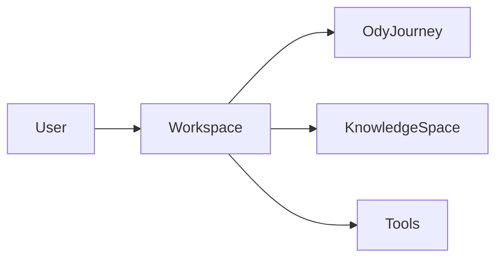
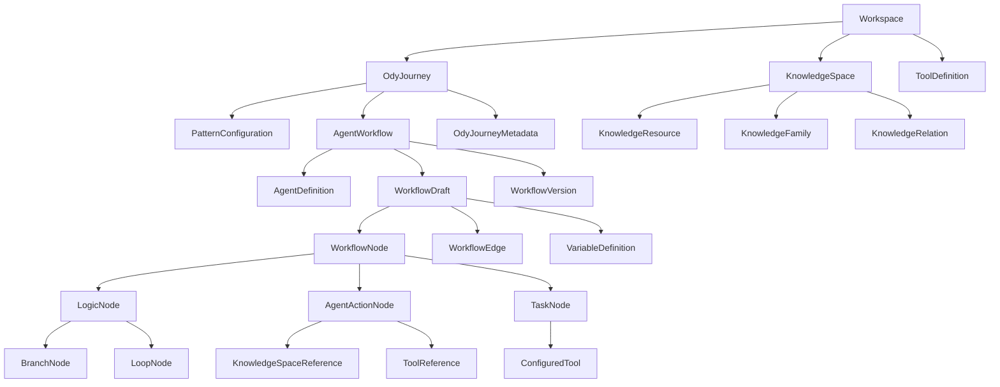
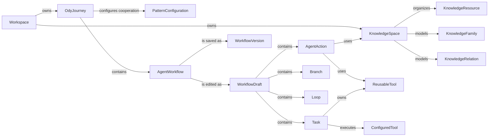

# Odyssey Domain Model

> Status: Draft for review  
> Scope: Odyssey v1 product domain  
> Purpose: Define the canonical product model shared by frontend, backend, persistence, Canvas, DSL, and future execution engine.

---

## 1. Purpose

This document defines the domain model of Odyssey.

It is not a database schema, API specification, Vue component hierarchy, or execution-engine implementation. Those layers should derive from this model without redefining its concepts.

The domain model is intended to become the shared source of truth for:

- frontend TypeScript models;
- backend Python models;
- REST API contracts;
- Canvas view-model adapters;
- PostgreSQL persistence;
- workflow import and export;
- future Odyssey DSL compilation;
- future runtime execution.

The v1 model deliberately focuses on product configuration and persistence. Runtime execution, scheduling, observability, collaboration, and permissions are future extensions unless explicitly included below.

---

## 2. Core Principles

### 2.1 One user, one Workspace

Odyssey v1 assumes a single-user product model.

A user has exactly one `Workspace`. There is no workspace switcher and no multi-workspace hierarchy.

The Workspace is the root ownership boundary for all persistent product objects.



Authentication and multi-user ownership are outside the v1 domain.

### 2.2 An OdyJourney represents one complete capability

An `OdyJourney` is a complete functional system configured by the user.

Examples:

- a research assistant;
- a knowledge-maintenance process;
- a document-curation process;
- a workflow-generation assistant.

An OdyJourney is not a single execution record and not merely a Canvas document. It is the persistent configuration of a complete Odyssey capability.

### 2.3 Agent is a Workflow type

In Odyssey, `Agent` is not a standalone actor entity placed inside another workflow.

An Agent is itself a specialized workflow.

Its internal Canvas may contain workflow nodes such as:

- Logic nodes;
- Agent Action nodes;
- Task nodes.

The term `Agent Action` refers to a node type inside an Agent workflow.

### 2.4 Pattern controls cooperation between Agents

A `Pattern` is an OdyJourney-level cooperation configuration.

It determines how top-level Agents route to one another.

A Pattern is not treated as a runtime object in v1. The selected Pattern configuration is persisted as part of the OdyJourney definition and materialized into read-only routing information on Agent workflow boundaries.

For example:

```text
Agent 1 → Agent 2 → Agent 3
```

The `End` node of Agent 1 routes to Agent 2.  
The `End` node of Agent 2 routes to Agent 3.  
The `End` node of Agent 3 terminates the OdyJourney.

This route is visible inside the Agent Canvas but cannot be changed there. It must be changed from the parent OdyJourney Pattern configuration.

### 2.5 Domain models must not depend on Canvas libraries

Odyssey domain objects must not store Vue Flow objects directly.

```text
Odyssey Domain Model
        ↓
Canvas View Model
        ↓
Vue Flow
```

Vue Flow node positions, viewport state, selection state, handles, and rendered edge details belong to the frontend Canvas adapter layer.

Domain-level nodes, routes, configuration, and identifiers belong to the Odyssey model.

### 2.6 Tool Definition and configured Tool are separate

A `ToolDefinition` describes a tool type and its configuration schema.

A `ConfiguredTool` is a configured instance of that definition.

A `ReusableTool` is a named, agent-level configured tool that may be reused across Agent Actions and Tasks.

A Task may also contain a locally configured tool that is not promoted to the reusable tool library.

---

## 3. Aggregate Overview



---

## 4. Workspace

### 4.1 Definition

`Workspace` is the single root container for a user's Odyssey environment.

There is exactly one Workspace in v1.

### 4.2 Suggested fields

```ts
interface Workspace {
  id: WorkspaceId
  name: string
  description?: string
  createdAt: Timestamp
  updatedAt: Timestamp
}
```

### 4.3 Owns

- OdyJourneys;
- Knowledge Spaces;
- Tool Definitions;
- future workspace settings.

---

## 5. OdyJourney

### 5.1 Definition

An `OdyJourney` is the persistent configuration of one complete Odyssey capability.

It coordinates one or more Agent workflows through a selected Pattern.

### 5.2 Suggested fields

```ts
interface OdyJourney {
  id: OdyJourneyId
  workspaceId: WorkspaceId
  name: string
  description?: string
  status: OdyJourneyStatus
  pattern: PatternConfiguration
  agentIds: AgentWorkflowId[]
  tags: string[]
  createdAt: Timestamp
  updatedAt: Timestamp
}
```

```ts
type OdyJourneyStatus =
  | 'draft'
  | 'ready'
  | 'needs_configuration'
  | 'archived'
```

### 5.3 Invariants

1. An OdyJourney belongs to exactly one Workspace.
2. An OdyJourney contains at least one Agent workflow before it may become `ready`.
3. Agent cooperation routes are controlled by the Pattern configuration.
4. Every Agent referenced by the Pattern must exist in the same OdyJourney.
5. Agent workflow internals cannot override Pattern-controlled Agent-to-Agent routes.

---

## 6. Pattern Configuration

### 6.1 Definition

`PatternConfiguration` defines how the Agent workflows inside an OdyJourney cooperate.

In v1, Pattern is treated as configuration rather than a separately executed runtime entity.

```ts
interface PatternConfiguration {
  patternType: PatternType
  slots: PatternSlot[]
  routes: PatternRoute[]
  configuration?: Record<string, unknown>
}
```

```ts
interface PatternSlot {
  slotId: PatternSlotId
  name: string
  order?: number
  assignedAgentId?: AgentWorkflowId
}
```

```ts
interface PatternRoute {
  sourceSlotId: PatternSlotId
  target:
    | { type: 'slot'; slotId: PatternSlotId }
    | { type: 'journey_end' }
}
```

```ts
type PatternType =
  | 'linear'
  | 'custom'
```

### 6.2 Relationship to Agent End nodes

Each Agent workflow contains a default `End` boundary node.

Its route is derived from the Pattern and is read-only inside the Agent Canvas.

```ts
interface AgentEndRoute {
  sourceAgentId: AgentWorkflowId
  target:
    | { type: 'agent'; agentId: AgentWorkflowId }
    | { type: 'journey_end' }
  source: 'pattern'
  editable: false
}
```

---

## 7. Agent Workflow

### 7.1 Definition

An `AgentWorkflow` is a specialized Workflow whose purpose is to perform goal-directed reasoning and action.

An Agent workflow contains:

- one default Start boundary node;
- one default End boundary node;
- zero or more workflow nodes;
- Agent-level definition and resources;
- variables;
- reusable tools;
- workflow draft and saved versions.

```ts
interface AgentWorkflow {
  id: AgentWorkflowId
  odyJourneyId: OdyJourneyId
  name: string
  description?: string
  definition: AgentDefinition
  workingDraft: WorkflowDraft
  currentVersionId?: WorkflowVersionId
  createdAt: Timestamp
  updatedAt: Timestamp
}
```

```ts
interface AgentDefinition {
  goal: string
  knowledgeSpaceIds: KnowledgeSpaceId[]
  reusableToolIds: ReusableToolId[]
}
```

This definition configures the Agent as a whole.

It must not be confused with `AgentActionNode`, which is one node type used inside the Agent workflow.

### 7.2 Start and End

`Start` and `End` are required boundary nodes.

Start:

- indicates where the Agent workflow begins;
- has no user configuration;
- cannot be deleted;
- cannot have incoming edges.

End:

- indicates completion of the Agent workflow;
- cannot be deleted;
- its outgoing Agent route is derived from the OdyJourney Pattern;
- the Pattern-controlled route is visible but read-only inside the Agent Canvas.

---

## 8. Workflow

A `Workflow` is an ordered graph of nodes and edges that defines the internal behavior of an Agent.

The workflow may contain explicit branching and controlled Loop subgraphs, but arbitrary graph cycles are forbidden.

```ts
type WorkflowNode =
  | StartNode
  | EndNode
  | BranchNode
  | LoopNode
  | AgentActionNode
  | TaskNode
```

The product UI may group these under broader categories:

```text
Logic
- Branch
- Loop

Action
- Agent Action
- Task
```

Here, the UI label `Agent` corresponds to an `AgentActionNode`.

```ts
interface WorkflowNodeBase {
  id: WorkflowNodeId
  workflowId: AgentWorkflowId
  nodeType: WorkflowNodeType
  name: string
  description?: string
}
```

Canvas position should be stored separately:

```ts
interface CanvasNodePlacement {
  nodeId: WorkflowNodeId
  x: number
  y: number
}
```

```ts
interface WorkflowEdge {
  id: WorkflowEdgeId
  workflowId: AgentWorkflowId
  sourceNodeId: WorkflowNodeId
  targetNodeId: WorkflowNodeId
  sourceHandle?: string
  targetHandle?: string
}
```

### 8.1 Graph invariants

1. Every Agent workflow has exactly one Start node.
2. Every Agent workflow has exactly one End node.
3. Start has no incoming workflow edges.
4. End has no editable outgoing workflow edges.
5. Arbitrary cycles are forbidden.
6. Repetition must be represented using a Loop node.
7. Loop nesting is forbidden in v1.
8. Agent Action cannot be placed inside a Loop.
9. Branch routes are represented by Canvas edges rather than a `routeTo` configuration field.
10. Task tools execute linearly in their configured order.

---

## 9. Branch Node

A `BranchNode` is a Logic node that evaluates ordered cases and routes execution to one outgoing branch.

```ts
interface BranchNode extends WorkflowNodeBase {
  nodeType: 'branch'
  cases: BranchCase[]
  defaultCaseId: BranchCaseId
}
```

```ts
interface BranchCase {
  id: BranchCaseId
  name: string
  conditions: BranchCondition[]
  matchMode: 'and'
}
```

```ts
interface BranchCondition {
  id: BranchConditionId
  leftOperand: Operand
  operator: ComparisonOperator
  rightOperand: Operand
}
```

Rules:

- a new Branch has `Case 1` and `Default`;
- users may add more cases;
- conditions inside one case use `AND` only in v1;
- Default has no condition;
- outgoing routes are represented by Canvas edges;
- Branch configuration has no editable `routeTo` field.

---

## 10. Loop Node

A `LoopNode` represents a controlled repeated subgraph.

It is the only supported way to express repetition in an Agent workflow.

Each Loop contains:

- one LoopStart;
- one LoopEnd;
- an internal subgraph.

The effective allowed v1 internal node types are:

- Task;
- Branch.

Agent Action is prohibited inside Loop in v1.

```ts
interface LoopNode extends WorkflowNodeBase {
  nodeType: 'loop'
  body: LoopSubgraph
  exitPolicy: LoopExitPolicy
  maxTurns: number
}
```

```ts
interface LoopExitPolicy {
  mode: 'variable_condition' | 'llm_goal'
  variableCondition?: BranchCondition
  llmGoal?: string
}
```

Rules:

1. Loop nesting is forbidden.
2. `maxTurns` is required and must be greater than zero.
3. Reaching LoopEnd completes one iteration; it does not automatically exit.
4. The Loop exits only when its exit policy is satisfied or `maxTurns` is reached.
5. `variable_condition` is recommended.
6. `llm_goal` is supported but should be marked as less deterministic.
7. No arbitrary workflow edge may create a cycle outside a Loop.

---

## 11. Agent Action Node

An `AgentActionNode` is a goal-directed reasoning/action node inside an Agent workflow.

It is not the top-level Agent workflow itself.

```ts
interface AgentActionNode extends WorkflowNodeBase {
  nodeType: 'agent_action'
  goal: string
  knowledgeSpaceIds: KnowledgeSpaceId[]
  reusableToolIds: ReusableToolId[]
  variableAccess: VariableAccessPolicy
}
```

An Agent Action has:

- Goal;
- zero or more Knowledge Spaces;
- zero or more tools in its Toolbox;
- explicit variable access.

Rules:

- it may reason and decide how to use configured resources;
- it may update only variables with explicit write permission;
- it is forbidden inside Loop in v1;
- it is distinct from deterministic Tool execution.

---

## 12. Task Node

A `TaskNode` is a deterministic, linear sequence of configured Tool executions.

Unlike an Agent Action, a Task does not choose which tool to call or in which order.

```ts
interface TaskNode extends WorkflowNodeBase {
  nodeType: 'task'
  steps: TaskToolStep[]
}
```

```ts
interface TaskToolStep {
  id: TaskToolStepId
  order: number
  tool: ConfiguredToolReference
  outputBinding?: VariableBinding
}
```

Rules:

1. A Task contains one or more Tool steps.
2. Tools execute strictly by ascending `order`.
3. Users may reorder Tool steps.
4. Every Tool step must be fully configured before the Task is valid.
5. Tool results should be explicitly bound to variables when downstream nodes consume them.
6. A Task has no internal branching.
7. A Task may be placed inside a Loop.

---

## 13. Tool Model

### 13.1 Tool Definition

A `ToolDefinition` describes a tool type and its configuration schema.

Examples:

```text
State
- Set Variable

Integration
- API Request

Knowledge
- Knowledge Retrieval

Computation
- Script Execution

Intelligence
- LLM Call
```

```ts
interface ToolDefinition {
  id: ToolDefinitionId
  key: string
  name: string
  category: ToolCategory
  description?: string
  source: 'built_in' | 'user_defined' | 'community'
  configurationSchema: JsonSchema
  inputSchema?: JsonSchema
  outputSchema?: JsonSchema
  version: string
}
```

### 13.2 Configured Tool

```ts
interface ConfiguredTool {
  id: ConfiguredToolId
  definitionId: ToolDefinitionId
  definitionVersion: string
  name: string
  configuration: Record<string, unknown>
  inputBindings: VariableBinding[]
  outputBinding?: VariableBinding
}
```

### 13.3 Reusable Tool

A `ReusableTool` is an Agent Workflow-owned configured Tool that can be referenced by multiple Agent Actions or copied into Task steps.

```ts
interface ReusableTool {
  id: ReusableToolId
  agentWorkflowId: AgentWorkflowId
  tool: ConfiguredTool
  description?: string
  tags: string[]
  createdAt: Timestamp
  updatedAt: Timestamp
}
```

A Task step owns a local configured snapshot. Dropping a Reusable Tool into a Task copies its current kind and configuration into a new Task-owned step ID. The copy may be edited independently, does not remain synchronized with the source, and survives later source edits or deletion.

Rules:

- Tool Definition and Configured Tool are always separate;
- configured tools retain the Tool Definition version used to create them;
- secret values must not be embedded in exported public workflow JSON;
- reusable references and local instances must be distinguishable.
- Agent Actions reference Reusable Tool IDs; Task steps do not keep a live Reusable Tool link in V1.

---

## 14. Variable Model

Variables provide explicit data exchange between nodes and Tool executions.

```ts
type VariableKind =
  | 'system'
  | 'user_input'
  | 'tool_managed'
  | 'agent_managed'
  | 'task_local'
```

System variables, such as `sys.current_message` and `sys.current_date`, are platform-defined and read-only.

```ts
interface VariableDefinition {
  id: VariableId
  workflowId: AgentWorkflowId
  key: string
  displayName: string
  kind: VariableKind
  dataType: VariableDataType
  defaultValue?: unknown
  readOnly: boolean
  systemDefined: boolean
}
```

```ts
type VariableDataType =
  | 'string'
  | 'number'
  | 'boolean'
  | 'json'
```

Task-local variables may initially be simplified to `string` or `json`, but this should be an implementation constraint rather than a separate conceptual model.

---

## 15. Knowledge Space

A `KnowledgeSpace` is a workspace-level collection of knowledge resources represented and maintained as a semantic graph.

The user-facing organization behaves like a file system. Folder structure is maintained and understood by the user.

The Odyssey knowledge model is independent of folder structure and represents resources through Knowledge Families and directed relations.

```ts
interface KnowledgeSpace {
  id: KnowledgeSpaceId
  workspaceId: WorkspaceId
  name: string
  description?: string
  workspaceTag?: string
  graphStatus: KnowledgeGraphStatus
  lastIndexedAt?: Timestamp
  lastStewardRunAt?: Timestamp
  createdAt: Timestamp
  updatedAt: Timestamp
}
```

```ts
type KnowledgeGraphStatus =
  | 'not_indexed'
  | 'indexing'
  | 'healthy'
  | 'needs_review'
  | 'failed'
```

Knowledge Spaces belong to the Workspace, not to an individual OdyJourney.

---

## 16. Knowledge Resource and File System

The canonical domain term is `KnowledgeResource`.

A file is the primary v1 resource type, but the abstraction allows future URLs, repositories, databases, conversations, and external sources.

```ts
interface KnowledgeResource {
  id: KnowledgeResourceId
  knowledgeSpaceId: KnowledgeSpaceId
  resourceType: KnowledgeResourceType
  name: string
  description?: string
  parentFolderId?: KnowledgeFolderId
  metadata: KnowledgeResourceMetadata
  storage?: StoredObjectReference
  indexingStatus: ResourceIndexingStatus
  createdAt: Timestamp
  updatedAt: Timestamp
}
```

```ts
type KnowledgeResourceType =
  | 'file'
  | 'url'
  | 'repository'
  | 'database'
  | 'conversation'
  | 'external'
```

Only `file` needs to be implemented in v1.

```ts
interface KnowledgeFolder {
  id: KnowledgeFolderId
  knowledgeSpaceId: KnowledgeSpaceId
  name: string
  parentFolderId?: KnowledgeFolderId
  createdAt: Timestamp
  updatedAt: Timestamp
}
```

Folders are user-maintained organization. They do not define graph semantics.

```ts
interface StoredObjectReference {
  provider: 'minio' | 'supabase' | 's3' | 'r2'
  bucket: string
  objectKey: string
  mimeType: string
  sizeBytes: number
  checksum?: string
}
```

Binary contents belong in object storage. PostgreSQL stores metadata and object references.

---

## 17. Knowledge Family and Relations

A `KnowledgeFamily` is a semantically connected group of resources inside a Knowledge Space.

It is not equivalent to a user folder.

```ts
interface KnowledgeFamily {
  id: KnowledgeFamilyId
  knowledgeSpaceId: KnowledgeSpaceId
  name: string
  description?: string
  tags: string[]
  resourceIds: KnowledgeResourceId[]
  status: KnowledgeFamilyStatus
}
```

```ts
type KnowledgeFamilyStatus =
  | 'healthy'
  | 'needs_review'
  | 'incomplete'
```

```ts
interface KnowledgeRelation {
  id: KnowledgeRelationId
  knowledgeSpaceId: KnowledgeSpaceId
  sourceResourceId: KnowledgeResourceId
  targetResourceId: KnowledgeResourceId
  relationType: KnowledgeRelationType
  summary?: string
  confidence?: number
  createdBy:
    | 'user'
    | 'document_curator'
    | 'knowledge_steward'
}
```

```ts
type KnowledgeRelationType =
  | 'references'
  | 'depends_on'
  | 'extends'
  | 'contradicts'
  | 'supports'
  | 'related_to'
```

The graph may be directed and cyclic.

---

## 18. Knowledge Maintenance Roles

Knowledge Steward and Document Curator are reusable OdyJourney configurations, not privileged backend entity types.

They use the same OdyJourney, Agent Workflow, Task, Tool, and Knowledge Space models as any other capability.

This preserves the principle that Odyssey's own system behaviors can be expressed through Odyssey.

---

## 19. Draft and Version Model

Editing a Canvas should not create a permanent version for every drag, node move, or field change.

Each Agent Workflow has one mutable Working Draft.

```ts
interface WorkflowDraft {
  workflowId: AgentWorkflowId
  revision: number
  nodes: WorkflowNode[]
  edges: WorkflowEdge[]
  variables: VariableDefinition[]
  canvasLayout: CanvasLayout
  validation: WorkflowValidationSummary
  updatedAt: Timestamp
}
```

The draft may be auto-saved to prevent data loss. Auto-save updates the mutable draft only.

The explicit user-facing `Save` action creates a new immutable `WorkflowVersion`.

```ts
interface WorkflowVersion {
  id: WorkflowVersionId
  workflowId: AgentWorkflowId
  versionNumber: number
  name?: string
  note?: string
  snapshot: WorkflowSnapshot
  createdAt: Timestamp
}
```

```ts
interface WorkflowSnapshot {
  nodes: WorkflowNode[]
  edges: WorkflowEdge[]
  variables: VariableDefinition[]
  canvasLayout: CanvasLayout
  agentDefinition: AgentDefinition
}
```

Recommended v1 behavior:

1. User edits the Working Draft.
2. Draft changes are auto-saved.
3. The UI indicates whether the draft differs from the latest saved version.
4. Clicking `Save` validates the draft.
5. If validation succeeds, Odyssey creates an immutable Workflow Version.
6. The new version becomes the current saved version.
7. An older version may be restored into the Working Draft.
8. Restoring does not delete later versions.
9. Editing after Save continues in the Working Draft.

A future `OdyJourneyRelease` may pin one saved version of each Agent plus a Pattern snapshot. This is not required for the first milestone.

For v1, `Save` is sufficient. A separate `Publish` action should be added only when Odyssey distinguishes saved configurations from a version selected for execution or public presentation.

---

## 20. Validation Model

Validation should be a domain service rather than scattered UI rules.

```ts
interface WorkflowValidationSummary {
  status: 'valid' | 'invalid' | 'warning'
  issues: ValidationIssue[]
}
```

```ts
interface ValidationIssue {
  code: string
  severity: 'error' | 'warning'
  message: string
  nodeId?: WorkflowNodeId
  fieldPath?: string
}
```

Example rules:

- Start and End must exist.
- Required nodes must be reachable from Start.
- No arbitrary cycle may exist.
- Loop cannot contain Loop.
- Agent Action cannot exist inside Loop.
- Branch must contain Default.
- Every Branch case must have an outgoing edge.
- Task steps must have unique linear order.
- Configured Tools must satisfy their Tool Definition schema.
- Pattern slots must reference valid Agents.
- Agent End routes must match Pattern configuration.
- Variable bindings must reference valid variables.
- Read-only variables cannot be written.

---

## 21. Persistence Boundaries

Persist as first-class records:

- Workspace;
- OdyJourney;
- Agent Workflow;
- Knowledge Space;
- Knowledge Folder;
- Knowledge Resource;
- Knowledge Family;
- Knowledge Relation;
- Tool Definition;
- Reusable Tool;
- Workflow Version.

Initially suitable for JSONB:

- Workflow Draft graph;
- Workflow Version snapshot;
- Pattern configuration;
- Configured Tool configuration;
- Canvas layout;
- Tool Definition JSON schemas.

Canvas-only transient state must not enter the core domain.

```ts
interface CanvasLayout {
  nodePlacements: CanvasNodePlacement[]
  viewport?: {
    x: number
    y: number
    zoom: number
  }
}
```

---

## 22. Import, Export, and Demo Seed

The First OdyJourney must be created through the normal frontend flow and generic backend APIs.

It must not be hardcoded into backend business logic.

A saved OdyJourney may be exported as a portable package and imported into an empty deployment database.

Seeded objects must remain editable through the same APIs as any frontend-created object.

Small immutable demonstration files may be bundled in the repository, but runtime Knowledge Space uploads must use object storage.

---

## 23. Out of Scope for v1

- multiple users;
- multiple Workspaces per user;
- Workspace roles;
- execution runs;
- runtime Agent instances;
- task queues;
- scheduling;
- observability traces;
- secret vault;
- collaborative editing;
- community marketplace;
- billing and quotas;
- full DSL compiler;
- Publish workflow;
- automatic Knowledge Steward execution;
- real-time graph indexing;
- resource types beyond files.

---

## 24. Canonical Terminology

| Term               | Meaning                                             |
| ------------------ | --------------------------------------------------- |
| Workspace          | The user's single root Odyssey environment          |
| OdyJourney         | One complete configured capability                  |
| Pattern            | OdyJourney-level Agent cooperation configuration    |
| Agent Workflow     | A goal-directed workflow coordinated by a Pattern   |
| Agent Action       | A reasoning/action node inside an Agent workflow    |
| Task               | A deterministic linear Tool-execution node          |
| Branch             | A conditional routing node                          |
| Loop               | A controlled repeated subgraph                      |
| Tool Definition    | A reusable description and schema for a tool type   |
| Configured Tool    | A concrete configuration of a Tool Definition       |
| Reusable Tool      | A agent-level configured Tool                       |
| Knowledge Space    | A workspace-level collection of knowledge resources |
| Knowledge Resource | A file or future external knowledge source          |
| Knowledge Family   | A semantic connected group within a Knowledge Space |
| Working Draft      | The mutable auto-saved workflow state               |
| Workflow Version   | An immutable snapshot created by explicit Save      |

---

## 25. Open Review Items

1. Whether Agent-level Goal, Knowledge Spaces, and Toolbox belong only to `AgentDefinition`, or whether the top-level Agent is purely a workflow container and all reasoning configuration belongs to Agent Action nodes.
2. Whether Agent Action is absolutely prohibited inside Loop in v1. This draft treats it as prohibited.
3. Whether Branch operators need variable-type-specific restrictions in v1.
4. Whether local configured Tools may be shared by multiple Tasks without becoming Reusable Tools.
5. Whether per-Agent Workflow Versions are sufficient, or whether OdyJourney-level Releases are needed from the start.
6. Whether `custom` Pattern is required in v1 or only predefined Pattern templates.
7. Whether one Knowledge Resource may belong to multiple Knowledge Families.
8. Whether Knowledge Relations are manually editable in v1 or display-only.

---

## 26. Recommended v1 Implementation Order

1. Workspace singleton.
2. OdyJourney CRUD.
3. Pattern configuration and Agent slots.
4. Agent Workflow creation.
5. Working Draft persistence.
6. Start and End boundary nodes.
7. Agent Action, Task, Branch, and Loop.
8. Tool Definition, Configured Tool, and Reusable Tool.
9. Variables and bindings.
10. Explicit Save and Workflow Version.
11. Knowledge Space file-system metadata.
12. Object-storage references.
13. First OdyJourney creation through the frontend.
14. Export and deployment seed.
15. Knowledge Family and graph display.

---

## Final Domain Boundary


