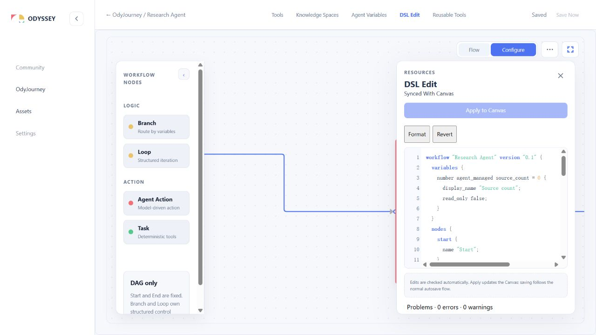

# DSL Edit 首版双向编辑集成报告

> Date: 2026-10-22  
> Status: 首版集成；不表示整个 V0.1 检查规范与所有后端增量已完成  
> Plan: [实施计划](./dsl-edit-bidirectional-sync-implementation-plan.md)

## 1. 本次落地

现有 Agent Workflow 页的 DSL Edit 入口已接真实编辑面板，无须下载/上传 JSON。流程是 Canvas canonical document → Printer → source；source → Parser/Compiler → canonical candidate → 专用 Store Apply → Canvas。JSON Import 原有重置/remap 行为保留，不用于面板提交。

- 独立 domain syntax/compiler/printer；花括号、注释、普通/raw 字符串、插值、变量 metadata、nodes/edges、Branch、Loop、五类 System Tool 和 Reusable Tools。
- UTF-16 source span、诊断 code/messageKey；文案在 feature 层映射，代码编辑区提供行号、着色、错误下划线、Problems 与跳转。
- 名称按 trim + NFC、大小写敏感解析，拒绝引用中的重名/未知资源；JSON 引用仍用内部 UUID。
- Printer 基线保留已有对象 ID、Tool labels/provenance、API header/form entry ID 和 layout；变量 key 非 identifier 时使用 identity variable_key metadata。
- Format / Apply / Revert；同一 Agent 关闭并重开面板保留草稿；dirty DSL 不进入保存 payload。
- 自动检查 250ms debounce、Canvas 回印 150ms debounce，避免每次 pointer update 打印；过期 context/stale 阻断。
- stale 或 alias 身份不明确时，显式 Review replacement 后基于当前 context 重检，再由用户 Apply；不把 review 本身当作提交。
- Apply 重新编译，校验 mutationSeq、Configure mode、saving/conflict、完整 schema/domain 与固定 End 集合，一次 markDirty，沿用既有 autosave/CAS。
- 路由离开与 beforeunload 将未应用 DSL 纳入现有 unsaved guard；未应用文本不伪装成已保存。

## 2. 当前合同覆盖

| 对象 | 已验证或实现 | 边界 |
| --- | --- | --- |
| Agent Variables | 类型/default/ownership/readOnly/displayName/description、别名与 key metadata | 全局资源创建/重命名的数据库唯一性未在此修改 |
| Agent Action | model/goal/knowledge/toolbox | Goal 自然语言行为不做执行保证 |
| Task | locals/ordered steps/input config/output/failure | 旧 step label 通过 baseline 保留，新 label 的独立 authoring 语法后续补齐 |
| System Tools | 五类配置和合法 JSON emission，输入/输出引用 | 不执行脚本或模型；动态输出类型留给未来 runtime |
| Branch/Loop | cases/default、比较、body graph（布局独立保留）、maxTurns/exit | 不支持 nested Loop，任意环阻断 |
| Root Ends | 固定 Pattern 边界、一一匹配现有 End、命名引用、内部入线 | 不能借 DSL 新增/删除/改目标；旧草稿“同出口创建多个 End”不作为该权限 |
| Layout/identity | DSL 无布局语法；Canvas 保留主图/body placements、viewport、尺寸，内部基线保留 UUID | alias 重命名同时增删对象时要求 review，不能保证独立 .ody 保留旧 UUID |
| Resources | 完整 Knowledge inventory + 当前 Agent Reusable Tools | inventory 缺失等待；不把当前资源浏览页当完整 inventory |

出口名称采用只读 adapter：target Slot.label / Journey End；标签不随目标 Agent 替换或 Slot 重排自动变化，规范化重名即阻断，不用 Agent 名称或数组下标猜测。它不新增 Pattern metadata，不声称已支持独立可编辑的 Accepted/Rejected 出口标签。已有 End/Slot 标签能唯一表示时可完成面板编排；独立出口命名持久化仍是后续合同增量。

## 3. 验证

- shared schemas 全量 93 tests 通过；Web 全量 497 tests 通过（该轮含 19 项 DSL 新测试）。之后补充编辑中截断输入回归，最终 DSL targeted 20 tests 全部通过。
- pnpm typecheck、pnpm lint、pnpm build 通过；最后的边界修复按变更范围复跑，production build 再次通过。
- 四份语言示例有明确 context 的编译测试；当前 research/loop canonical fixtures 做完整配置往返；五种 Tool 的 label、header/form IDs、默认值和配置深比较。
- Store 测试验证一次 mutation、无效/stale/只读零 mutation、DSL 面板保留，以及通过 Repository save/reload 恢复。
- 真实浏览器通过独立 `apps/web/acceptance/dsl.html` 验收入口，挂载真实 App/router/Canvas/DSL 组件，Repository 使用现有 InMemory 实现；该 HTML 不作为生产构建入口。
- 浏览器已验证 DSL 改 Goal → Apply → Canvas，Canvas 键盘改 Goal → DSL 回印；未知变量显示定位错误、Apply 禁用，关闭重开保留错误草稿。

浏览器验收使用 test fixture，没有编辑真实 Journey。实际 HTTP 后端的端到端保存暂未验收：现有 API 不接受独立测试端口的 origin，备用 API 端口被系统拒绝绑定；未改现有 API/CORS 配置、未停止他人进程。内存 Repository browser 验收与单元 Store 保存测试不等于 PostgreSQL 持久化证据。

## 4. 后续增量

1. 在实际开发 API 环境补 HTTP save/reload 与 revision conflict 浏览器验收，以及 1024×900/1440×900 响应验收。
2. 补 resource 创建/重命名入口与后端的统一名称唯一性；历史规范化碰撞不自动改名或合并。
3. 如需自定义业务出口标签，实施父 Pattern metadata/inventory 合同及迁移，并保留当前固定 End 生命周期。
4. 接真实 System Variable inventory；当前没有系统 inventory 时 sys 引用返回 context-required，不伪造 UUID。
5. 逐项扩展检查规范 golden cases、related spans/typed diagnostic parameters，以及更精细的多错误恢复、比较类型边界和大文档基准。当前 parser 输出带位置的语法结构，不能把首版覆盖率宣称为规范所有规则已完成。
6. 补齐独立 .ody / JSON 文件编译 adapter、可选草稿恢复；面板当前已能完成主链路，不依赖这些文件能力。

本报告记录实际交付与限制，不将待办勾成完成。源文本草稿目前仅保留在当前 Agent 页面会话中，刷新前的离开提示不能替代持久化备份。

更新决策：layout 不进入 DSL；仅布局变化不使草稿 stale，Apply 保留最新 Canvas 布局。

当前节点语法：`类型 "名称" { ... }`，连线按双引号名称引用；不使用节点 alias 或块内 name。同图名称规范化后唯一，Loop body 独立；内部 UUID 继续由会话保留。详见语言规范的“节点名称语法决策”。

## 2026-10-23 真实后端补验收

已用独立 Workspace、API 8315、Web 5173 和 PostgreSQL 55432 验证 DSL Apply → autosave → reload。另用两个浏览器窗口复现真实 revision conflict，确认保留本地修改、暂停保存，并在两步确认 Reload 后恢复服务器内容。未知变量错误会阻止 Apply；未应用草稿离开页面时出现保护提示。Overwrite 和所有网络失败时序尚未逐项验收。

本轮还修复了 DSL 新建 Loop 子节点横向排列到容器外的问题，保留已有布局。详细步骤、测试和截图见 [验收记录](../../project/odyssey-acceptance-2026-10-23.md)。
