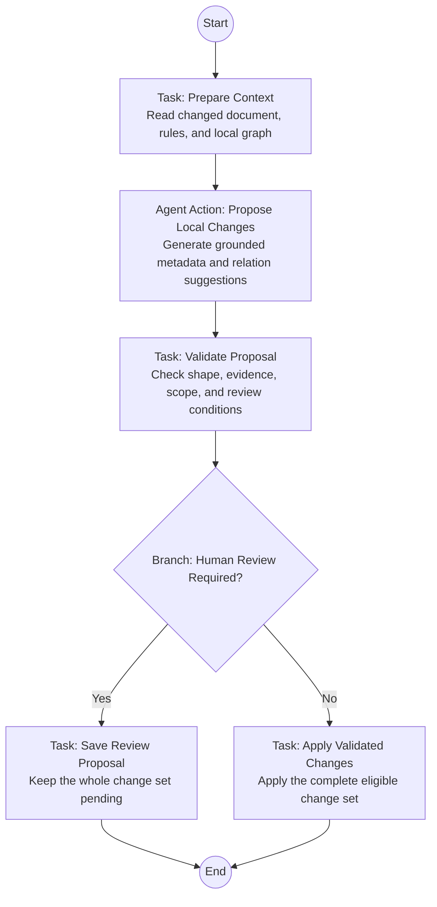

# Document Curator: Detailed Workflow Design

> Status: V0.2 design proposal — simplified for the current editor-only stage.
> Updated: 2026-10-25
> Pattern: Solo; one Agent, one business Branch, one Pattern-owned End.
> Deliverable: Workflow design, tool-configuration intent, data contracts, static scenario expectations, and a design-only DSL draft.

## 1. Current goal and explicit scope

Design a useful Document Curator Workflow that can later be represented in the existing editor. Odyssey currently has no execution kernel. This stage does not require new System Tool types, real domain APIs, mock APIs, event listeners, transactional write services, review storage, or a simulated executor.

We define what each node would consume and produce, then use static scenario data to check that the design is coherent. A Canvas configuration, a fixture, or a goal instruction does not establish executable behavior.

This revision replaces the earlier two-Branch/four-disposition Canvas design. Event deduplication, version rejection, logging, result publication, and recovery remain future execution requirements; they are no longer separate user-authored Workflow nodes.

## 2. Knowledge resources

| Resource | Role | Intended access |
| --- | --- | --- |
| Document Curator Playbook | Complete maintenance rules | Read-only, explicitly configured policy input |
| Target Moonberry game KS | The changed document, metadata, tags, neighboring documents, and relationships | Scoped evidence reads; only validated local annotation changes are eventually writable |

Use a separate game KS or snapshot for this case so the First Case Q&A fixture remains intact. Its final name/identity is a setup choice, not permission to write to every accessible KS.

The Playbook contains:

- [Metadata Guidelines](./maintenance-rules/metadata-guidelines.md)
- [Relationship Guidelines](./maintenance-rules/relationship-guidelines.md)
- [Review & Change Policy](./maintenance-rules/review-and-change-policy.md)

All three texts must be available at the selected policy versions. A semantic search returning one rule is not complete policy loading. Rules are trusted only through explicit Agent/deployment configuration; a healthy KS graph or retrieved instruction does not grant authority.

## 3. Simplified Workflow

There is one business decision: **apply automatically or save for review**. All normal paths reach the single existing Solo End. Do not create extra Pattern exits for processing statuses.

Only a technically valid proposal reaches the Branch. Invalid input, failed reads, unauthorized operations, malformed model output, and stale versions must stop processing through future tool/execution error handling. “No” does not mean “ignore validation failures.”

No Branch is needed for no-change, duplicate-event, or stale-version outcomes:

| Situation | Where it belongs | Canvas consequence |
| --- | --- | --- |
| No effective changes and no unresolved findings | Validator produces an eligible empty change set; apply capability returns no_change without writing the graph | Follow the normal automatic path |
| Valid candidate with review findings | Validator sets requiresReview = true, even if operations is empty | Follow the review path |
| Replayed completed event | Future invocation/prepare contract returns the prior receipt and short-circuits the invocation | No extra node or model invocation |
| Invalid or stale input/proposal | Future read/validation/commit capability rejects it; execution layer reports the outcome | Do not continue into apply |
| Logging and result delivery | Future execution layer and terminal tool receipts | No Record Result or Publish Result Task |

Short-circuiting/error termination are future execution contracts, not existing editor features claimed by this design. For now, capture these outcomes in static fixtures.

## 4. Inputs and logical data contracts

A future invocation represents one committed document addition or content update. Until event delivery exists, use a static event/context example rather than implementing a listener.

| Record | Required design content | Owner |
| --- | --- | --- |
| Change input | eventId, eventType, Workspace/target KS binding, document identity, source revision; optional previous revision | Trusted invocation context |
| Prepared context | Current source text, existing metadata/ownership, tag inventory, incident relationships, relevant source evidence, complete policy snapshot and revisions | Prepare Context Task |
| Proposal | Proposed operations, supporting passages/locators, expected prior values, unresolved findings and proposed issues | Agent Action |
| Validation result | Valid normalized change set, requiresReview boolean, reasons, proposal identity, protected source/graph/policy revisions | Validate Proposal Task |
| Terminal result | applied, no_change, or review_required receipt; future failures/rejections reported separately | Apply/Review capability and execution layer |

These are logical contracts, not new canonical fields, installed tools, or current API DTOs. Exact schemas and Agent Action structured-output delivery must be specified before execution implementation. A JSON variable does not by itself validate or authorize its contents.

The model cannot set the trusted requiresReview flag, approve itself, or manufacture a committed result. The validator owns the Branch input. A missing or unknown boolean is invalid, not an automatic-apply default.

## 5. Task: Prepare Context

### Responsibility

Provide enough current, scoped context for one local maintenance proposal.

### Intended inputs and reads

- The changed document and its exact readable source revision.
- Existing Summary, Guide, tag memberships, producer ownership, and any human edits.
- Existing incoming/outgoing relationships and relevant neighboring documents.
- Explicit document references in the changed source and their resolution results.
- The target KS tag inventory and the full Playbook rule snapshot.

A previous source version is optional. If unavailable, compare current source against existing metadata without inventing a historical diff.

### Output and limits

Return one prepared context. Never derive a summary from a filename alone. Missing current source, policy text, permission, or required revision information prevents normal processing.

The target is local: inspect incident relationships and relevant candidates, not an unbounded whole-KS traversal. Required read truncation must be explicit; incomplete evidence cannot silently justify automatic writes. Runtime pagination, candidate limits, and read-set freshness belong to later tool contracts.

## 6. Agent Action: Propose Local Changes

### Goal

Using the Playbook and current game evidence, propose the changed document's metadata and affected local relationships. Identify conflicts or uncertainties requiring review. Do not mutate game source text or graph data.

### Configuration intent

| Setting | Content |
| --- | --- |
| Knowledge | Document Curator Playbook plus the explicitly bound target game KS |
| Toolbox | Existing knowledge_retrieval instances for relevant evidence where appropriate; future read-only API Request instances for exact source/context reads if needed |
| Prepared input | Full changed source, rules, ownership, tags, and existing incident relationships |
| Output | Structured proposal with operations, evidence, and unresolved findings |
| Excluded access | Direct graph writes, source editing, approval, policy changes, and cross-KS mutation |

Knowledge selection makes content available but does not prove retrieval occurred. Generic knowledge_retrieval does not replace precise revision, provenance, or incident-edge reads. The model may use additional read-only discovery when needed, while keeping the proposal within the fixed local boundary.

### Proposal work

1. Draft Summary and Guide grounded in the changed document, preserving constraints.
2. Suggest existing tags; place new-tag requests in review findings.
3. Resolve explicit references and gather supporting passages from relevant documents.
4. Compare possible conflicts under matching conditions, including Silverfin location, season, weather, and time.
5. Propose operations and separately list uncertainties. Never substitute guessed target IDs for ambiguous references.

Keep the whole candidate together. The model does not choose which safe subset to commit.

## 7. Task: Validate Proposal

### Responsibility

Check the candidate and produce a trustworthy review decision. This is not a second request for the model to approve its own work.

### Validation concerns

- Shape, operation/relation enums, required fields, and resolvable identities.
- All writes stay in the bound target KS and involve only changed-document metadata or incident relationships.
- Evidence passages/locators match the referenced source versions.
- Human, other-producer, and unknown-provenance annotations remain protected.
- True no-op operations and duplicate memberships/edges are removed without changing existing identity.
- The maintenance-rule allowlist and review requirements are respected.
- Required source, graph, neighbor-evidence, and policy revision checks are represented.

A script can check format, enums, and other supplied-data invariants. It cannot establish database permission or commit-time freshness. Likewise, finding a quotation does not mechanically prove semantic support or resolve a conflict. Such uncertainty stays review-required.

### Decision

- Reject a technically invalid or stale candidate; it does not reach the Branch.
- Set requiresReview = true for conflicts, protected metadata changes, new tags, removals, non-reference additions, or other valid unresolved findings.
- Otherwise set requiresReview = false and supply the complete allowlisted change set.
- An empty change set with no finding is valid; it can proceed to a no-op apply result.

If any operation needs review, route the entire candidate to review. Do not automatically apply an otherwise-safe metadata subset.

## 8. Branch: Human Review Required?

The Branch reads only requiresReview from the valid service-produced validation result:

| Condition | Destination |
| --- | --- |
| requiresReview equals true | Save Review Proposal |
| requiresReview equals false | Apply Validated Changes |

When translating this to actual Branch configuration, preserve fail-closed behavior: require a valid boolean before entry; an unexpected value must not be treated as approval. Default routing can use the review path if the editor requires a Default, but the validation contract must still reject malformed states.

No additional model call or independent KS read is needed for this Branch.

## 9. Task: Apply Validated Changes

Consume the validated candidate, not arbitrary model text. Its intended operations are the initial policy allowlist: owned Summary/Guide creation or refresh, additions to existing tag memberships, and evidence-backed explicit references. Preserve all unrelated data and source content.

A future implementation must recheck permissions and the protected read set immediately before committing, apply the whole change set atomically, and return a durable result. An eligible empty change set returns no_change without graph mutation. Conflicts or failed writes must not report applied.

Current-stage deliverable: define a static request/result example for a permitted change set and an empty one. Do not develop a mock endpoint, database writer, transaction service, or execution plugin now.

## 10. Task: Save Review Proposal

Consume the entire valid candidate with its review reasons, proposed operations, existing values, evidence, and protected revisions. Return an intended review record identifier and review_required status.

Do not apply pending metadata or relationships. Scenario B includes both incompatible Silverfin passages and a proposed possible_conflict issue. Graph-issue publication is not required for this stage; review storage and optional issue projection are future separate contracts.

Human approval is asynchronous and outside this Workflow. This invocation ends after saving the proposal; it does not wait at a hidden approval node. A later approved application must revalidate versions and scope. Approval cannot make an invalid reference valid or grant authority to edit protected source text.

Current-stage deliverable: a static review request/result example. No review API, queue, database, or approval UI is required now.

## 11. Existing tool types and planned instances

Do not introduce a System Tool kind for every business capability. The existing catalog provides knowledge_retrieval, api_request, script_execution, set_variable, and llm_call. They express configurations; they are not evidence that a kernel or execution adapter exists.

| Node | Existing type/configuration direction | Resource/data | Current deliverable |
| --- | --- | --- | --- |
| Prepare Context | api_request instance: Read Curator Context | Target game data plus complete pinned Playbook policies | Describe request/response; static context fixture |
| Propose Local Changes | Agent Action with knowledge_retrieval and, if required, scoped read-only api_request instances | Playbook and target game KS | Goal, tool/KS assignments, structured proposal contract |
| Validate Proposal | api_request instance: Validate Curator Proposal; script_execution may cover only local format checks | Candidate, policies, evidence, ownership, versions | Define validation input/result and review decision |
| Apply Validated Changes | api_request instance: Apply Curator Changes | Complete eligible change set and expected revisions | Static applied/no-change result |
| Save Review Proposal | api_request instance: Save Curator Review | Whole candidate and evidence | Static review-required result |
| Branch | No tool | Valid requiresReview boolean | Condition design |

Thus four conceptual API Request instances are sufficient for the main Task steps. Their names are configuration intentions, not deployed endpoints. No real or mock API is being developed. Do not invent reachable URLs, credentials, or additional Tool kinds just to make the Canvas look executable. How these bindings will be represented in a later DSL is a separate design step.

## 12. Static scenarios for this stage

Keep scenario and expected-result materials outside both KSs. They are examples, not retrieval evidence or a hand-written mock executor.

| Scenario | Static material to prepare | Expected design outcome |
| --- | --- | --- |
| A: Add Rainy Day Activities | New source, baseline tags/relations, grounded candidate | Existing tags and three explicit references can be eligible; automatic path returns applied |
| B: Update Fishing Guide | Updated weather rule, unchanged contradictory Rainy Day Activities, both passages | Whole candidate follows review path; no game-graph change |
| C: No effective change | Accurate existing metadata and no unresolved findings | Empty change set follows automatic path; result no_change |
| D: Stale revision | Expected revision differs from current revision | Rejected by validation/commit contract; not a third business Branch |

For A, new-tag requirements or uncertain ownership instead route the whole candidate to review. Exact operation counts await source authoring. For B, do not choose a winner or apply the safe metadata subset. For D, the future execution layer reports stale and may schedule a fresh invocation; this DAG has no retry loop.

Additional paper checks: a replay returns the prior outcome; missing rules stop preparation; a conflict with no operations still needs review; a failed write cannot claim success; a pre-existing unrelated issue must not be cleared.

## 13. Acceptance boundaries

### Now: design and editor configuration

- Node responsibilities and input/output contracts are understandable.
- One Agent Action has explicit KS/read-only toolbox intent.
- One Branch represents the actual business choice.
- Static scenarios cover apply, review, no-change, and stale outcomes.
- Later DSL work verifies that supported nodes, variables, edges, and tool settings can be expressed and saved in Canvas. Unavailable endpoints remain documented dependencies, not working services.

### Later: kernel and service implementation

Event handling, durable deduplication, revision-aware reads, structured Agent Action output, provenance enforcement, atomic updates, review persistence, receipt recovery, failure reporting, and real retrieval need execution contracts and tests when the kernel is implemented. They must not be deleted from the safety requirements, but they do not need separate visible nodes today.

A single End means the invocation has finished. It does not imply that changes were applied; the terminal outcome may be applied, no_change, or review_required. Future blocked/stale/failed outcomes belong to execution reporting and must remain distinguishable from success.

## 14. Next design deliverables

1. Review this simplified flow and its single review decision.
2. Prepare the baseline/incoming game sources and expected changes without altering the First Case fixture.
3. Specify concise context, proposal, validation, apply-result, and review-result records with static examples.
4. Then design DSL and editor configuration using existing node/tool types.

No new tools, real APIs, mock APIs, kernel, event system, or persistence implementation is required for the current stage.

## 15. First DSL draft and concrete tool steps

[document-curator.ody](./document-curator.ody) is a design-only configuration draft using current syntax and existing System Tool types. No endpoint or kernel is implemented. The example.invalid URLs are intentionally non-operational placeholders; the event identity/revision values are illustrative inputs, not actual uploaded resource IDs. The target KS name Moonberry Island - Curator Demo is a proposed demo binding to create or replace explicitly.

| Node | Ordered steps / configuration |
| --- | --- |
| Read Document Context — Task | api_request → context |
| Propose Local Changes — independent Agent Action | Both KS assignments; read-only Find Related Game Documents reusable knowledge_retrieval tool; candidate → proposal is a pending execution contract |
| Validate Proposal — Task | script_execution checks operations/findings arrays and builds request → api_request validates domain concerns → script_execution extracts a verified boolean |
| Choose Disposition — Branch | requires_review == false → Auto Apply; Default → Human Review |
| Apply Validated Changes — Task | api_request submits the complete validation envelope → result |
| Save Review Proposal — Task | api_request stores the complete validation envelope → result |

Task contains only sequential tool steps. No Task embeds an Agent Action. llm_call and set_variable remain available System Tool types but are not needed in this draft. Scripts do not prove semantic validity, permission, or freshness; those remain requirements on the future validation/application capability.

Proposed context response: complete current source, metadata/provenance, tag inventory, incident graph, policy texts/snapshot, and revision references. Proposed validation response: valid, requiresReview, normalized proposal, findings/reasons, and the protected context/revision identity needed by both terminal operations. The validator must preserve the whole candidate for the review path and never return an executable authorization for a rejected candidate. Terminal results expose applied/no_change/review_required only after the corresponding future operation succeeds. Exact schemas are still to be frozen.

The discovery tool currently binds a fixed query tailored to Scenario A; it is not a claim that the executor supports agent-generated query arguments. The full prepared context remains the primary input. Generalized discovery input binding can be designed later.

The main remaining handoff is Agent Action structured proposal delivery: current syntax has no generic node output mapping. Requiring agent.proposal in goal text expresses intent, not a working implementation. No API or runtime needs to be developed now; this draft can validate language/configuration expressibility but cannot be described as runnable.

DSL validation (2026-10-25): the draft compiled without diagnostics against explicit Playbook/target inventories and passed JSON → DSL → JSON equivalence checks. This verifies configuration expressibility, not API availability, script sandbox behavior, or Agent Action execution.

Assumed API contracts and complete static request/response examples are available in [API Contracts](./api-contracts.md). They match the four API Request steps in document-curator.ody; no real or mock API is implemented.

## 16. Variable type inventory check

Checked against the current implementation on 2026-10-25: the variable panel offers String, Number, Boolean, and Object / JSON. Their canonical and DSL types are string, number, boolean, and json. The Curator draft uses existing lowercase json declarations for structured records and boolean for requires_review; it does not introduce a Json or object type. Keep these declarations rather than silently serializing every record as a string. The validation Task explicitly extracts the boolean because DSL member access is not supported. The language/design specifications now record this capability constraint.

## 17. Generic target binding decision (2026-10-25)

The Curator is intended to process file events from any authorized Knowledge Space, not only the Moonberry demo. Keep the Playbook fixed; the next DSL binds knowledge and retrieval target directly through `$sys.target_knowledge_space$`. The system determines the event document’s KS, validates ownership/access, and provides a read-only typed resource reference. This is not a model inference or an ordinary string variable. See [Runtime Variable Binding Design](../../../planning/implementation/DSL/runtime-variable-binding-design.md). Current .ody and assumed API examples remain the legacy static-target illustrations until parser/canonical/editor support is implemented; do not interpret their fixed demo KS as the generic contract.
