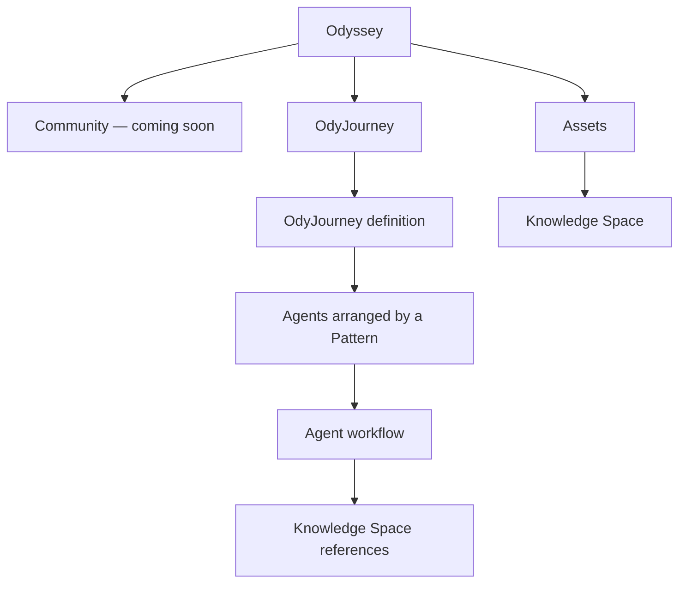
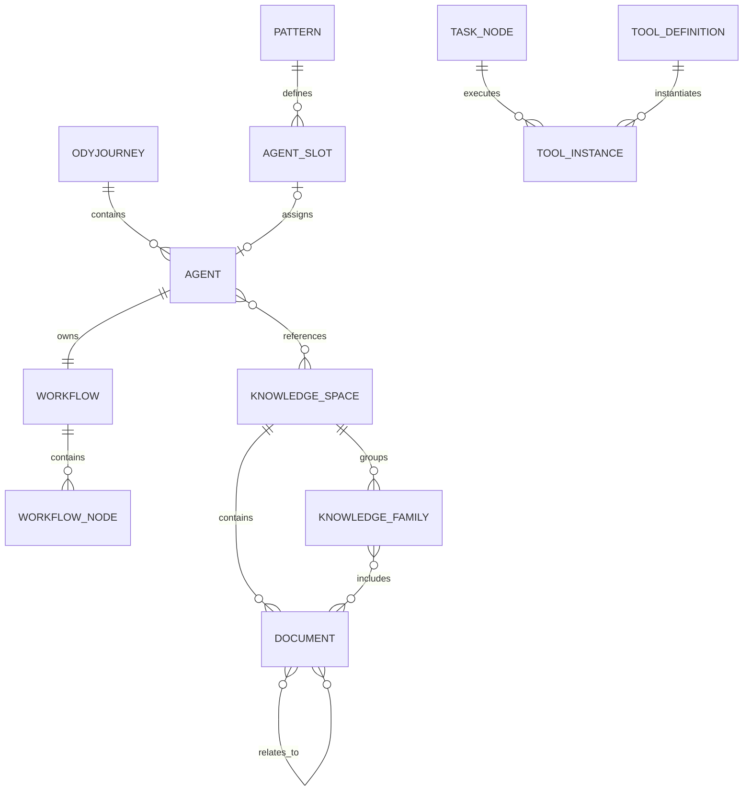
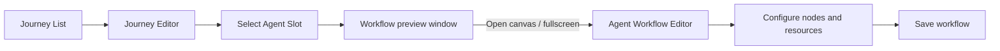
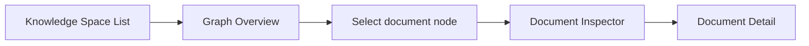

# Odyssey Figma Information Architecture

> Purpose: help Codex understand the product hierarchy, route structure, entity relationships, and the difference between full pages and UI-state variants before implementing the Odyssey web application.
>
> Figma source: [Odyssey Design](https://www.figma.com/design/P3EF9io2DhyhwkNYBVqB5Z/Odyssey-Design?node-id=1-2)
>
> Scope: this document describes the current Figma draft. It is an implementation map, not a requirement to reproduce every experimental or hidden Figma layer.

## 1. Product Mental Model

Odyssey has two primary working domains:

1. **OdyJourney** — where users design an agent system and edit the workflow of each agent.
2. **Assets** — reusable resources referenced by agents and tasks. In v1, the principal asset is **Knowledge Space**.

**Community** is a future distribution layer for reusable patterns, agents, tools, and other components. It is visible in global navigation but should be treated as unavailable in v1.



The key implementation distinction is:

- An **OdyJourney** owns the system-level configuration and agent cooperation structure.
- An **Agent** belongs to an OdyJourney and owns one workflow canvas.
- A **Knowledge Space** is an independent asset. Agents reference it; it is not nested inside the agent or journey record.
- Tools may be built-in definitions, reusable user assets, or tool instances attached to a Task.

## 2. Canonical Navigation Hierarchy

```text
Odyssey
├── Landing / Workspace Entry
├── Community [coming soon]
├── OdyJourney
│   └── Journey List
│       └── Journey Editor
│           └── Agent Workflow Editor
└── Assets
    └── Knowledge Space
        └── Knowledge Space List
            └── Knowledge Space Detail
                └── Document Detail
```

This is the product hierarchy. It should not be inferred directly from the physical positions of frames on the Figma canvas.

### Landing and Workspace entry decision

The existing Odyssey landing page at `/` is retained as the product entry page. The Figma-designed application shell does not replace this landing page.

The landing page's **Open workspace** action enters the single Odyssey Workspace and navigates to the Figma-designed product interface. For V1, the destination is the Journey List at `/journeys`; the user can then open a Journey Editor and nested Agent Workflow Editor through the canonical hierarchy below.

```text
Landing `/`
→ Open workspace
→ Journey List `/journeys`
→ Journey Editor `/journeys/:journeyId`
→ Agent Workflow Editor `/journeys/:journeyId/agents/:agentId`
```

V1 has one application Workspace and does not require a Workspace picker or Workspace CRUD screen. The **Open workspace** control is navigation into the existing singleton Workspace, not creation of a new Workspace record.

## 3. Route Map

The exact frontend framework is not prescribed. The paths below are recommended semantic routes.

| Product level | Recommended route | Figma frame | Responsibility |
| --- | --- | --- | --- |
| Landing / Workspace Entry | `/` | Existing implemented landing page; retained outside the Figma application shell | Product introduction and entry into the singleton Workspace |
| Community | `/community` | Not designed; coming soon | Placeholder/disabled navigation item in v1 |
| Journey List | `/journeys` | `OdyJourney — Journey List` (`247:33`) | Search, filter, create, and open OdyJourneys |
| Journey Editor | `/journeys/:journeyId` | `OdyJourney · UI Draft` → `OdyJourney — Resource Library Open` (`59:2`) | Configure Pattern, Execution, Behavior, and Agents at system level |
| Journey Editor — Pattern tab | `/journeys/:journeyId?tab=pattern` | `OdyJourney — Pattern Templates` (`300:33`) | Select/configure the cooperation Pattern from a template library |
| Journey Editor — Execution tab | `/journeys/:journeyId?tab=execution` | `OdyJourney — Execution Templates` (`302:33`) | Select/configure the system Execution structure from a template library |
| Journey Editor — Behavior tab | `/journeys/:journeyId?tab=behavior` | `OdyJourney — Behavior Coming Soon` (`303:33`) | v1 placeholder for future execution behaviors |
| Agent Workflow Editor | `/journeys/:journeyId/agents/:agentId` | `Research Agent — Workflow Canvas` (`62:2`) | Build and configure the selected agent's workflow |
| Knowledge Space List | `/assets/knowledge-spaces` | `OdyJourney — Asset - Knowledge Space` (`145:8`) | Search, filter, create, and open Knowledge Spaces |
| Knowledge Space Detail | `/assets/knowledge-spaces/:knowledgeSpaceId` | `Knowledge Space — Graph Overview` (`147:44`) | Browse folder structure, metadata, Knowledge Families, and document graph |
| Document Detail | `/assets/knowledge-spaces/:knowledgeSpaceId/documents/:documentId` | `Knowledge Space — Document Detail` (`157:2`) | Inspect/edit a document and its graph metadata |

### Route behavior

- Clicking **Open workspace** on the retained landing page navigates to `/journeys`.
- Clicking a Journey card opens the Journey Editor.
- Clicking a configured Agent slot selects it and displays that Agent's workflow in a floating preview window at the lower-right of the Journey Editor. This does **not** navigate away.
- Clicking the preview window's upper-right **Open canvas / fullscreen** control navigates to the Agent Workflow Editor for that Agent.
- The Agent slot context-menu action **Open workflow** may navigate directly to the same Agent Workflow Editor.
- The Agent Workflow Editor's Back action returns to its owning Journey Editor.
- Clicking a Knowledge Space card opens Knowledge Space Detail.
- Selecting a document graph node opens an inspector overlay first; clicking **Open document** navigates to Document Detail.
- Browser back/forward should preserve real navigation. Temporary panels should use URL search parameters only when deep-linking is useful; otherwise keep them as local UI state.

## 4. Full Pages vs UI-State Variants

Do **not** implement every top-level Figma frame as a separate route. Several frames are snapshots of the same page in different interaction states.

### 4.1 Journey Editor states

Within `OdyJourney · UI Draft` (`39:4`):

| Figma frame | Interpretation |
| --- | --- |
| `OdyJourney — Resource Library Open` (`59:2`) | Journey Editor with the Agent library/resource area visible |
| `Research Agent — Workflow Canvas` (`62:2`) | The nested Agent Workflow Editor, not merely a Journey Editor tab |
| `Agent Workflow Canvas — Resource Configuration` (`98:2`) | Agent Workflow Editor with a resource/configuration surface open |
| `OdyJourney — Pattern Templates` (`300:33`) | Journey Editor with Pattern tab selected and Pattern template library visible |
| `OdyJourney — Execution Templates` (`302:33`) | Journey Editor with Execution tab selected and Execution template library visible |
| `OdyJourney — Behavior Coming Soon` (`303:33`) | Journey Editor with Behavior tab selected; v1 coming-soon state |

The Journey Editor itself has system-level tabs such as **Pattern**, **Execution**, **Behavior**, and **Agent**. These are views of one OdyJourney record and should share one page route. A `tab` search parameter is recommended only if direct linking and browser-history behavior are desired.

#### Agent Slot preview interaction

An Agent Slot is not a direct page link. It supports progressive disclosure:

1. The user clicks a configured Agent Slot.
2. The slot becomes selected.
3. A floating workflow preview appears at the lower-right of the System Canvas, visually similar to a picture-in-picture video window.
4. The preview shows a compact, read-only representation of that Agent's current workflow.
5. Clicking the preview's upper-right **Open canvas / fullscreen** control opens the full Agent Workflow Editor route.


Preview requirements:

- Only one Agent workflow preview should be open at a time.
- Selecting another configured slot replaces the preview content.
- Clicking the currently selected slot may keep the preview open; closing behavior should be explicit through a close action or selection change.
- The preview is read-only and optimized for orientation, not node configuration.
- It should preserve the workflow's topology while simplifying labels and controls to remain legible at small size.
- The preview belongs to Journey Editor UI state and must not receive its own route or backend entity.

### 4.2 Agent Workflow Editor states

The following Figma frames represent one workflow editor with different panels or modes:

| State | Figma frame | Implementation form |
| --- | --- | --- |
| Default canvas | `Research Agent — Workflow Canvas` (`62:2`) | Base page |
| Agent Variables | `Agent Workflow Canvas — Agent Variables` (`119:2`) | Right-side panel |
| Create Variable | `Agent Workflow Canvas — Create Variable` (`132:2`) | Panel state layered over the same canvas |
| Modify Variable | `Modify Variable panel` (`118:6`) | Reusable panel component, not a route |
| Focus Mode | `Agent Workflow Canvas — Focus Mode` (`166:2`) | Layout mode that hides surrounding navigation and maximizes canvas |
| Tool Configuration | `Agent Workflow Canvas — Tool Configuration (Knowledge Retrieval)` (`177:33`) | Tool configuration panel |
| Reusable Tools | `Agent Workflow Canvas — Reusable Tools` (`194:33`) | Reusable-tools browser panel |
| Reusable Tool Instance | `Agent Workflow Canvas — Reusable Tool Instance` (`195:33`) | Configuration of a linked tool instance |

The separate narrow built-in tool frames are panel specifications, not pages:

- `Built-in Tool Panel — Script Execution` (`182:33`)
- `Built-in Tool Panel — API Request` (`183:33`)
- `Built-in Tool Panel — Set Variable` (`185:33`)
- `Built-in Tool Panel — LLM Call` (`189:33`)

Use a common panel shell and render a type-specific form inside it.

### 4.3 Knowledge Space Detail states

| State | Figma frame | Implementation form |
| --- | --- | --- |
| Graph overview | `Knowledge Space — Graph Overview` (`147:44`) | Base detail page |
| Document selected | `Knowledge Space — Document Inspector` (`148:58`) | Base page plus inspector overlay/drawer |
| Document opened | `Knowledge Space — Document Detail` (`157:2`) | Full nested route |

`Document Inspector` is deliberately an intermediate state: it supports quick graph exploration without forcing a page transition. `Document Detail` is the durable page for deeper reading or editing.

## 5. Page Responsibilities

### 5.1 Journey List

Primary responsibilities:

- Display journeys grouped by ownership/scope, currently **My Journeys** and **Workspace Journeys**.
- Search by name or description.
- Filter by status, owner, and recent update.
- Create a new OdyJourney.
- Open an existing OdyJourney.

The cards are summaries, not workflow previews. Expected summary fields include name, description, status, metadata, and last updated time.

### 5.2 Journey Editor

The Journey Editor is the system-level design surface. It configures a single OdyJourney through stable conceptual areas:

- **Pattern** — the cooperation topology and agent slots.
- **Execution** — the active system flow.
- **Behavior** — cross-cutting execution rules, policies, and observability.
- **Agent** — agent definitions/assignments associated with pattern slots.

In the current v1 Figma:

- The Pattern tab exposes a **Pattern template library** beside the System Canvas.
- The Execution tab exposes an **Execution template library** beside the same System Canvas.
- The Behavior tab intentionally renders a **Coming Soon** library/placeholder. It should preserve the tab and layout position without implying that behavior configuration is already functional.

The canvas depicts a fixed system structure: input guardrail, execution module, output guardrail, and execution behavior. Agent slots inside the execution module are configured here. The detailed internal workflow of an Agent is edited one level deeper in Agent Workflow Editor.

Implementation rule: do not duplicate agent workflow editing inside Journey Editor. Clicking an Agent Slot opens a read-only, picture-in-picture-style workflow preview at the lower-right. Only the preview's Open canvas/fullscreen action—or the slot context menu's explicit Open workflow action—opens the nested Agent Workflow Editor.

### 5.3 Agent Workflow Editor

The Agent Workflow Editor is a node-based canvas belonging to exactly one Agent.

Main areas:

- Global/product navigation shell.
- Node palette.
- Workflow canvas.
- Canvas mode controls: Flow / Configure.
- Focus Mode.
- Resource panels: Tools, Knowledge Space, Agent Variables, DSL Edit, and Reusable Tools.
- Contextual configuration panels for selected nodes, variables, and tools.

Current node concepts visible in the draft include:

- Start and End
- Agent Action
- Task
- Branch
- Loop

A Task contains a linear sequence of configured tool instances. Tools are not independent workflow nodes. Branching occurs at the workflow level through Branch nodes.

### 5.4 Knowledge Space List

Primary responsibilities:

- Group Knowledge Spaces by their single Knowledge Space Category (UI label: Category); this is not a Workspace type.
- Search and filter by category, graph status, and recent update.
- Create a Knowledge Space.
- Show summary cards with name, description, health/status, counts, and update information.

### 5.5 Knowledge Space Detail

The detail page combines two distinct structures:

- A user-maintained folder tree for document organization.
- A system-maintained knowledge graph grouped into Knowledge Families.

The graph, not the folder hierarchy, represents semantic relationships used by the system and LLMs. A Knowledge Space can contain multiple Knowledge Families; it is not a single connected graph.

Main areas:

- Folder tree and file actions.
- Knowledge Space overview metadata.
- Graph canvas with Knowledge Family boundaries.
- Document nodes and directed relations.
- Graph legend/status.
- Document Inspector when a node is selected.

### 5.6 Document Detail

Document Detail is scoped to one document inside one Knowledge Space. It should expose the document content and graph-facing metadata such as tags, references, summary, and navigation guide. It is reached from the inspector or another document link and retains a clear path back to the parent Knowledge Space.

## 6. Core Entity Relationships



Important ownership rules:

- Deleting an Agent may delete or detach its Workflow, depending on product policy, but must not delete referenced Knowledge Spaces.
- Deleting a Knowledge Space requires reference checks because multiple Agents may use it.
- A Tool Instance stores per-use configuration; a reusable Tool Definition remains independently manageable.
- A document belongs to one Knowledge Space in v1, while Knowledge Family membership is graph-derived and may change after stewardship/indexing.

## 7. Recommended Frontend Component Boundaries

```text
AppShell
├── GlobalNavigation
├── ProductHeader / Breadcrumbs
└── RouteOutlet

JourneyListPage
├── ListToolbar
├── JourneySection
└── JourneyCard

JourneyEditorPage
├── JourneyTabs
├── AgentLibrary
├── SystemCanvas
├── AgentSlot
└── WorkflowPreview

AgentWorkflowPage
├── WorkflowHeader
├── NodePalette
├── WorkflowCanvas
├── WorkflowNode
├── CanvasModeToggle
├── FocusModeShell
└── SidePanelHost
    ├── AgentVariablesPanel
    ├── VariableFormPanel
    ├── KnowledgeSpacePickerPanel
    ├── ReusableToolsPanel
    └── ToolConfigurationPanel

KnowledgeSpaceListPage
├── ListToolbar
├── KnowledgeSpaceSection
└── KnowledgeSpaceCard

KnowledgeSpaceDetailPage
├── FolderTree
├── KnowledgeSpaceOverview
├── KnowledgeGraphCanvas
├── KnowledgeFamilyGroup
├── DocumentGraphNode
└── DocumentInspector

DocumentDetailPage
├── DocumentHeader
├── DocumentContent
└── DocumentMetadata
```

Prefer reusable primitives for the shared navigation shell, cards, toolbars, status indicators, drawers, and configuration panels. Avoid copying entire Figma frames into separate page components.

## 8. Suggested State Model

Separate persisted domain data, route state, and temporary UI state.

### Persisted domain data

- OdyJourney configuration
- Pattern and agent-slot assignments
- Agent definition and workflow graph
- Variables and permissions
- Tool definitions and tool-instance configuration
- Knowledge Space metadata, documents, Knowledge Families, and graph edges

### Route state

- `journeyId`
- `agentId`
- `knowledgeSpaceId`
- `documentId`

### Temporary UI state

- Active Journey Editor tab
- Selected Agent Slot and open workflow preview
- Selected workflow node
- Selected graph document node
- Open side panel and panel mode
- Flow / Configure canvas mode
- Focus Mode
- Search/filter values before submission
- Unsaved form drafts

Do not persist temporary Figma snapshot states as independent backend entities.

## 9. V1 Scope Guidance

### Implement

- Global navigation and shared app shell.
- Journey List → Journey Editor → Agent Workflow Editor path.
- Knowledge Space List → Detail → Document Detail path.
- Core canvas presentation and CRUD-oriented configuration flows.
- Variable panels and simplified built-in tool configuration.
- Graph display and document inspector interaction using static or mocked graph data if the engine is not yet available.

### Defer or stub

- Community marketplace/distribution.
- Full execution engine.
- Automatic Knowledge Steward/Document Curator runs beyond representative status and mock data.
- Advanced reusable-tool lifecycle if it blocks the core editing flow.
- Exact parity with every hidden or experimental layer in the Figma file.

## 10. Figma Interpretation Rules for Codex

1. Treat named, visible top-level product frames as references, not as a one-frame-one-route mandate.
2. Use the canonical hierarchy and route map in this document when Figma layer placement is ambiguous.
3. Hidden layers generally represent experiments, inactive states, or copied scaffolding. Do not render them by default.
4. Repeated navigation, toolbar, and canvas layers should become reusable components.
5. A narrow 384 px configuration frame is a side-panel specification, not a standalone page.
6. Preserve the two-level design boundary: Journey/system configuration above, Agent workflow configuration below.
7. Preserve the asset boundary: Knowledge Spaces are referenced resources, not children owned by an Agent.
8. Preserve progressive disclosure in Knowledge Space: overview → inspector → full document.
9. When a visual detail conflicts with a domain rule, keep the domain rule and flag the visual discrepancy.
10. Before implementing a specific screen, inspect that exact Figma node for detailed layout, typography, spacing, and states; this document only defines the structural relationship.

## 11. Known Naming Notes

- Use **Assets** for the top-level navigation label and **Knowledge Space** for the asset type.
- Use **Journey Editor** as the implementation name for the frame titled `OdyJourney · UI Draft`.
- Use **Agent Workflow Editor** for `Research Agent — Workflow Canvas`; “Research Agent” is example data, not the page type.
- `OdyJourney — Pattern Templates`, `OdyJourney — Execution Templates`, and `OdyJourney — Behavior Coming Soon` are Journey Editor tab states, not three standalone product pages.
- Use **Document Inspector** for the transient graph overlay and **Document Detail** for the full page.
- Some copied frames contain hidden layers from other screens. Frame titles and visible content take priority over those copied hidden layers.

## 12. Minimal End-to-End User Flows

### Configure a journey and its agent



### Explore a Knowledge Space



These two flows form the structural backbone of the current Odyssey v1 demo.
