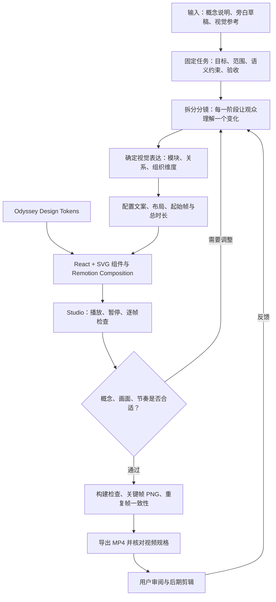
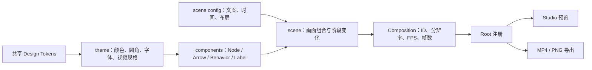
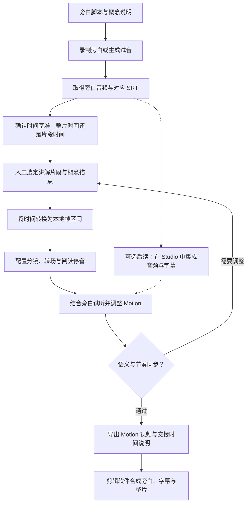

# Odyssey Motion 制作工作流

日期：2026-10-27。状态：试验阶段工作约定，随实际视频制作迭代。

本文记录当前 Motion 001 的实际制作方式，并提出未来接入旁白、SRT 的轻量流程。当前已具备独立 Motion 预览、逐帧渲染和导出能力；尚未实现 SRT 解析、音频合成或字幕自动驱动动画。

开始新任务时，复制 [制作表模板](./templates/motion-production-template.md) 到本目录下填写 A～D；可参考 [Motion 001 填写示例](./examples/motion-001-brief-sample.md)。AI 负责检查素材、生成 E～G 的分镜与验收记录；这是一份协作约定，当前没有填表即自动渲染的程序。

## 1. 当前工作方式

每支 Motion 从“观众需要理解什么”开始，先确定概念关系与分镜，再用共享组件实现，在 Studio 中调整节奏，最后导出视频交给剪辑。React + Remotion 是独立制作工具，业务前端继续使用 Vue 3；两者通过 Design Tokens 保持视觉一致。



这里的循环是制作过程中的反馈，不是视频中的系统执行流程。

## 2. 人与代码如何分工

| 阶段 | 需要确定的内容 | 留下的结果 |
| --- | --- | --- |
| 概念与任务 | 要解释的概念、不能误导的关系、视频用途 | 本目录下的 task 文档 |
| 分镜 | 哪些元素先出现，何时建立连接，最后停留在哪个结构 | 分镜说明与时间表 |
| 视觉实现 | 布局、对齐、文字层级、颜色、出现方式 | scene 与基础组件 |
| 节奏调整 | 每段动画的起点、过渡长度、阅读停留 | 配置与 Studio 预览 |
| 技术验收 | 类型、bundle、输出规格、确定性 | 检查结果与媒体预览 |
| 内容审阅 | 表达是否准确、是否配合讲解、观众能否跟上 | 用户反馈与下一轮修订 |

我负责把概念转成可审阅的分镜和代码，并执行技术检查。你通过预览判断表达与节奏是否符合视频讲解，必要时修改概念表达、画面重点或旁白。技术验收通过不等于内容已经定稿。

## 3. 当前代码如何组织



- `motion/src/theme/index.ts`：直接引用共享颜色与圆角，统一视频规格与排版。
- `motion/src/components/`：可复用的 SVG 展示和帧动画组件。
- `motion/src/scenes/motion001Config.ts`：Motion 001 的文案、核心布局、起始帧和总帧数。
- `motion/src/scenes/ExecutionDimensions.tsx`：把组件组合成画面；分镜中的部分标注位置与过渡时长仍在 scene 中，不是所有参数都已配置化。
- `motion/src/compositions/Motion001.tsx`：注册独立视频规格与 Composition ID。
- `motion/out/`：导出视频、关键帧和临时验收文件，已被 Git 忽略。

当前所有动画均由帧计算，不依赖定时器或 CSS 自动播放。拖动到某一帧，画面就由该帧确定。相同环境下已经验证重复帧导出一致；跨机器精确一致还需要固定字体与浏览器版本。

## 4. Motion 001 的实际时间轴

当前规格：1920 × 1080、30 FPS、300 帧、10 秒、无声。帧从 0 开始，最后一帧是 299。

| 起始帧 | 视频时间 | 画面动作 | 目的 |
| --- | --- | --- | --- |
| 12 / 30 / 48 | 0.4 / 1.0 / 1.6 秒 | 三个模块依次出现 | 先建立横向模块结构 |
| 75 / 96 | 2.5 / 3.2 秒 | 两条箭头依次生长 | 表达简化执行顺序 |
| 126 | 4.2 秒 | Behavior 贯穿区域出现 | 引入不同的组织维度 |
| 192 | 6.4 秒 | 横向推进与纵向行为标注出现 | 明确两个维度的区别 |
| 228～299 | 7.6～10.0 秒前 | 最终画面停留 | 给观众阅读与理解时间 |

这段 10 秒动画目前是视觉与工具链样片，**没有与完整中文旁白进行时长或语速匹配**。原旁白信息量较大，后续可能需要延长 Composition、拆成多个镜头，或只将此 Motion 放在某段旁白下。不能因为已有 10 秒成片就把讲解强行压入 10 秒。

## 5. 未来结合旁白与 SRT 的流程

建议下一轮先采用“旁白确定节奏，SRT 提供定位，人工确定概念转场”的方式。SRT 通常记录字幕段的起止时间与文字，未必对应词级时间；一句话也可能被拆成多条字幕，因此字幕分段不能直接当作分镜分段。



图中 SRT、音频相关环节为拟议流程；当前代码没有实现自动导入，也没有集成音频或字幕预览。

第一步甚至不需要写 SRT 解析器：提供 SRT 与旁白后，先人工读出相关区间，把时间锚点写进 task 和 scene config，验证真实制作是否顺畅。反复出现同样的时间转换工作后，再增加小型导入脚本。

### 时间基准与帧换算

先区分整片的绝对时间与单支 Motion 从 0 开始的本地时间。例如，Motion 从整片第 62 秒开始，某概念在 SRT 的第 65.2 秒出现，则它在 Motion 中的位置为 3.2 秒，对应 30 FPS 下第 96 帧。

```text
localSeconds = subtitleSeconds - clipStartSeconds
anchorFrame = round(localSeconds × fps)

例：round((65.2 - 62.0) × 30) = 96
```

时间区间建议统一为 `[startFrame, endFrameExclusive)`：起始向下取整、结束向上取整，再限制到 Composition 范围。用于概念动作的单点锚点可取最近帧。锚点在片段外时先检查选段是否正确，不直接把所有负数压到第 0 帧。

SRT 常用毫秒格式，例如 `00:01:05,200`。解析时保留整数毫秒，最后转换到帧，避免逐段累计取整造成漂移。若素材从 30 FPS 改为其他 FPS，应从原始时间重新计算，而不是缩放已经取整的帧号。

### 字幕时间如何影响动画

| 旁白语义锚点 | 对应视觉变化 | 制作判断 |
| --- | --- | --- |
| 开始解释横向模块 | 模块开始出现 | 留出读懂名称的时间 |
| 解释执行关系 | 连接逐渐建立 | 视讲解需要稍提前展示或同步出现 |
| 引入 Execution Behavior | 贯穿区域出现 | 不因字幕换行而重复淡入 |
| 对比是否推进系统状态 | 两个维度的标注成为重点 | 降低无关变化，保留结论画面 |

动作可以围绕旁白锚点设置提前量、过渡长度和停留时间，具体值由试听决定，不设置一套通用的强制偏移。Motion 的解释性标签与底部旁白字幕是两类文字，应分别排版并预留字幕安全区。

默认可继续导出无声 Motion，在剪辑软件中合并旁白与字幕；如果需要更精确的同步审阅，再考虑把同一段音频与字幕加入 Studio。届时应分别保留“审阅用带声版本”和“剪辑用无声版本”的明确命令，避免重复叠加音轨。

## 6. 每支 Motion 的最小交接资料

后续任务建议记录：

1. Motion ID、名称、解释目标与语义约束。
2. 对应视频、旁白版本、SRT 版本；没有素材时明确标为草稿。
3. 选段起止时间、素材时间基准与是否保留前后余量。
4. 概念锚点、各分镜的出现与停留区间。
5. 分辨率、FPS、总时长、是否带音频或烧录字幕。
6. 关键帧、导出路径、验证结果和用户待审事项。

旁白或 SRT 更新后，应重新确认锚点与总时长，再导出；不要只替换字幕文字就假设时间仍然正确。媒体文件按现有约定留在忽略目录，任务文档记录可辨认的文件名与版本。

## 7. 预览、导出与检查

以下命令在仓库根目录执行，当前脚本默认指向 Motion 001：

```bash
pnpm --filter @odyssey/motion studio
pnpm --filter @odyssey/motion build
pnpm --filter @odyssey/motion preview
pnpm --filter @odyssey/motion still out/frame-090.png --frame=90
pnpm --filter @odyssey/motion render
```

每次完成修改，先检查涉及的关键帧和转场，再检查整段播放。交付时核对分辨率、帧率、帧数、时长、音轨、文字裁切、概念准确性与输出文件。若引入旁白，还需检查声音与画面是否同步、片段边界是否切断语句、字幕是否遮挡图形。复用工作区不代表可以跳过内容审阅。

## 8. 下一步的合理范围

先用一段真实旁白与对应 SRT 做完整试制，手工标注时间并调整 Motion 001，确认工作流后再决定是否增加 SRT 解析与音频审阅能力。当前不建设时间轴编辑器、自动字幕分镜引擎或视频管理平台。

相关资料：[资料与素材目录](./README.md)、[Motion 001 任务与验收](./motion-remotion-mvp-task.md)、[工作区命令与结构](../motion/README.md)。
